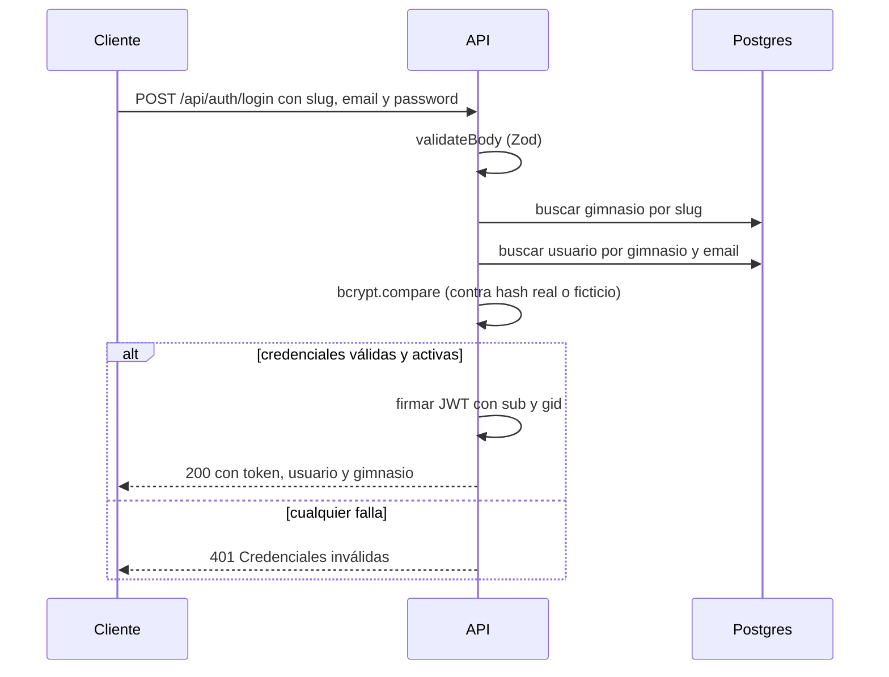
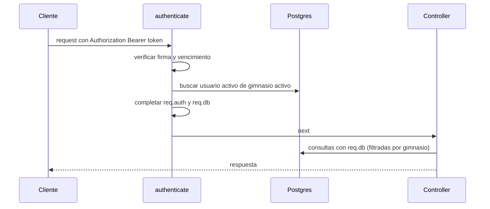

# Autenticación y multi-tenancy (backend)

Documentación del módulo de autenticación de `apps/api`: cómo se registra un gimnasio, cómo se inicia sesión, cómo se protegen las rutas y cómo se garantiza que un gimnasio nunca vea los datos de otro.

**Versiones de referencia:** Express 5.2.1 · Prisma 7.10.0 · Zod 4.6.5 · jsonwebtoken 9.0.3 · bcrypt 6.0.0 · express-rate-limit 8.x · Vitest 5.1.0

---

## 1. Resumen

- FitManager es **multi-tenant**: varios gimnasios comparten la misma base de datos. Cada gimnasio es un *tenant*.
- Las tablas de negocio llevan una columna `gimnasioId`, y toda consulta tiene que filtrar por ella. La excepción temporal es `Horario` (ver sección 14).
- La autenticación usa **JWT** (HS256, 8 horas). El token identifica al usuario y a su gimnasio.
- El filtrado por gimnasio **no se escribe a mano en cada query**: lo hace un cliente de Prisma especial (`req.db`) que agrega el `gimnasioId` automáticamente.
- Hay dos roles: `ADMIN` y `RECEPCIONISTA`. Los profesores y los socios no tienen usuario en el sistema. Solo los `ADMIN` gestionan al personal (crear usuarios, cambiar roles, desactivar y resetear contraseñas); cualquier usuario puede cambiar su propia contraseña.
---

## 2. Conceptos clave

| Concepto | Qué es |
|---|---|
| **Gimnasio (tenant)** | Un cliente del sistema. Tiene un `slug` único (por ejemplo `fitzone-bahia-blanca`) que lo identifica. |
| **Usuario** | Cuenta del staff de un gimnasio (admin o recepción). El email es único **dentro de cada gimnasio**, no global. |
| **Slug** | Identificador del gimnasio en el login. Más adelante saldrá del subdominio. |
| **`req.auth`** | Datos del usuario autenticado (id, rol, gimnasio). Lo completa `authenticate`. |
| **`req.db`** | Cliente de Prisma limitado al gimnasio del usuario. Lo completa `authenticate`. |

### Por qué el login pide el slug del gimnasio

El mismo email puede existir en dos gimnasios distintos (por ejemplo, alguien que trabaja en ambos). Sin el slug no hay forma de saber a cuál cuenta corresponde la contraseña.

---

## 3. Endpoints

Prefijos: `/api/auth` (sesión y cuenta propia) y `/api/usuarios` (gestión del personal, solo `ADMIN`).

### `POST /api/auth/register-gimnasio`

Crea un gimnasio nuevo y su primer usuario administrador, en una sola transacción: si falla una de las dos cosas, no se crea ninguna.

**Request**

```json
{
  "gimnasio": {
    "nombre": "Gym Test",
    "slug": "gym-test",
    "email": "contacto@gymtest.com",
    "telefono": "291-1234567",
    "direccion": "Av. Colón 123"
  },
  "admin": {
    "nombre": "Ana",
    "apellido": "Test",
    "email": "ana@gymtest.com",
    "password": "password123"
  }
}
```

Los campos `email`, `telefono` y `direccion` del gimnasio son opcionales.

**Respuesta `201`**

```json
{
  "token": "eyJhbGciOi...",
  "usuario": {
    "id": "uuid",
    "email": "ana@gymtest.com",
    "nombre": "Ana",
    "apellido": "Test",
    "rol": "ADMIN"
  },
  "gimnasio": { "id": "uuid", "nombre": "Gym Test", "slug": "gym-test" }
}
```

**Errores:** `400` validación · `409` el slug ya está en uso.

---

### `POST /api/auth/login`

**Request**

```json
{
  "gimnasioSlug": "fitzone-bahia-blanca",
  "email": "admin@fitzone.com",
  "password": "admin123"
}
```

**Respuesta `200`:** misma forma que el registro (`token`, `usuario`, `gimnasio`).

**Errores:** `400` validación · `401` credenciales inválidas.

El `401` usa **siempre el mismo mensaje** (`Credenciales inválidas`), sea que falle el gimnasio, el email, la contraseña o el usuario esté desactivado. Así no se puede averiguar qué emails están registrados.

---

### `GET /api/auth/me`

Devuelve quién es el usuario logueado. Requiere el header `Authorization: Bearer <token>`.

**Respuesta `200`**

```json
{
  "usuario": {
    "id": "uuid",
    "email": "admin@fitzone.com",
    "nombre": "Ana",
    "apellido": "Administradora",
    "rol": "ADMIN"
  },
  "gimnasio": { "id": "uuid", "nombre": "FitZone Bahía Blanca", "slug": "fitzone-bahia-blanca" }
}
```

**Errores:** `401` token ausente, inválido o vencido, o usuario desactivado.

**Para qué sirve:** el frontend lo llama al arrancar para restaurar la sesión después de recargar la página (el estado en memoria se pierde, el token guardado no), para mostrar los datos del usuario y para adaptar la interfaz al rol. Como los datos salen de la base en cada llamada, refleja cambios de rol o desactivaciones al instante.

---

### `POST /api/auth/change-password`

Cambia la contraseña del usuario logueado. Requiere `Authorization: Bearer <token>`. Sirve para cualquier rol.

**Request**

```json
{
  "currentPassword": "clave-actual",
  "newPassword": "clave-nueva-123"
}
```

**Respuesta `204`**, sin cuerpo.

**Errores:** `400` validación, contraseña actual incorrecta o nueva igual a la actual · `401` sin sesión · `429` demasiados intentos.

Una contraseña actual incorrecta responde `400` y **no** `401`, a propósito: el frontend interpreta un `401` como sesión vencida y cierra la sesión, y acá el usuario solo se equivocó de contraseña.

---

### Gestión de usuarios del personal (`/api/usuarios`)

Todas las rutas requieren `Authorization: Bearer <token>` y rol `ADMIN` (un `RECEPCIONISTA` recibe `403`). Trabajan sobre `req.db`, así que solo ven y modifican usuarios del propio gimnasio.

| Ruta | Qué hace | Éxito |
|---|---|---|
| `GET /api/usuarios` | Lista los usuarios del gimnasio, ordenados por apellido y nombre | `200` |
| `POST /api/usuarios` | Crea un usuario | `201` |
| `PATCH /api/usuarios/:id` | Actualiza nombre, apellido, rol o `activo` | `200` |
| `POST /api/usuarios/:id/reset-password` | Fija una contraseña nueva a **otro** usuario | `204` |

**Forma de un usuario en las respuestas** (nunca incluye `passwordHash`):

```json
{
  "id": "uuid",
  "email": "dani@fitzone.com",
  "nombre": "Dani",
  "apellido": "Gómez",
  "rol": "RECEPCIONISTA",
  "activo": true,
  "createdAt": "2026-10-20T15:00:00.000Z"
}
```

**Bodies**

```json
// POST /api/usuarios (rol es opcional y por defecto RECEPCIONISTA)
{ "nombre": "Dani", "apellido": "Gómez", "email": "dani@fitzone.com", "password": "clave-nueva-1", "rol": "RECEPCIONISTA" }

// PATCH /api/usuarios/:id (al menos un campo)
{ "nombre": "Daniela", "rol": "ADMIN", "activo": true }

// POST /api/usuarios/:id/reset-password
{ "password": "clave-reseteada-1" }
```

**Reglas**

- **Un admin no puede desactivarse ni cambiar su propio rol** (`409`). Esto garantiza que el gimnasio siempre tenga al menos un administrador activo: quien hace la llamada es un admin activo (lo verifica `authenticate`) y no puede dejar de serlo por su cuenta.
- **No se puede resetear la contraseña propia** (`409`): se usa `POST /api/auth/change-password`, que exige la contraseña actual.
- **El email no se puede modificar.** Un campo no permitido (`email`, `passwordHash`, `gimnasioId`) se rechaza con `400`.
- **Crear un usuario con un email que ya existe en el gimnasio** responde `409`, aunque el existente esté desactivado.
- **Un usuario de otro gimnasio responde `404`**, igual que uno inexistente.
- **Desactivar corta el acceso al instante**, porque `authenticate` verifica el estado en cada request. Los usuarios no se borran, solo se desactivan.

## 4. Reglas de validación

Definidas con Zod en `auth.schema.ts`.

| Campo | Regla |
|---|---|
| `email` | Se recorta y pasa a minúsculas antes de validar. Tiene que ser un email válido. |
| `password` (registro) | Entre 8 y 72 caracteres. El máximo existe porque bcrypt solo considera los primeros 72 bytes. |
| `password` (login) | Solo se exige que no esté vacía, para no bloquear cuentas creadas con reglas anteriores. |
| `slug` | De 3 a 40 caracteres. Solo minúsculas, números y guiones, sin guion al inicio ni al final. |
| `slug` reservados | `www`, `api`, `app`, `admin`, `login`, `static`, `assets` (se van a usar como subdominios). |
| `gimnasio.nombre` | Entre 2 y 100 caracteres. |
| `admin.nombre` / `apellido` | Entre 1 y 60 caracteres. |
| `rol` (crear usuario) | `ADMIN` o `RECEPCIONISTA`. Si se omite, se crea como `RECEPCIONISTA` (mínimo privilegio). |
| `nombre` / `apellido` (usuarios) | Entre 1 y 60 caracteres, igual que en el registro. |
| `PATCH /api/usuarios/:id` | Campos permitidos: `nombre`, `apellido`, `rol`, `activo`, y al menos uno. Cualquier otro campo se rechaza con `400` en lugar de ignorarse. |
| `:id` (rutas de usuarios) | Tiene que ser un UUID válido; si no, `400`. |
| `newPassword` / `password` (cambio y reset) | Misma regla que el registro: entre 8 y 72 caracteres. |
| `currentPassword` | Solo se exige que no esté vacía. |

Un body inválido responde `400` con este formato:

```json
{
  "error": "Error de validación",
  "details": { "...": "estructura de z.treeifyError" }
}
```

---

## 5. Flujos

### Login



### Request autenticada



---

## 6. JWT

| Propiedad | Valor |
|---|---|
| Algoritmo | `HS256` (se fija al firmar y al verificar) |
| Duración | 8 horas |
| Secreto | Variable de entorno `JWT_SECRET` (validada en `config/env.ts`) |
| Payload | `sub` = id del usuario · `gid` = id del gimnasio · más `iat` y `exp` automáticos |

El token **no incluye el rol ni datos personales**. El rol se lee de la base en cada request (ver `authenticate`), de modo que desactivar a un usuario o cambiarle el rol tiene efecto inmediato y no al vencer el token.

El payload se valida con Zod después de verificar la firma, en vez de confiar en lo que devuelve la librería.

**No hay refresh tokens.** Pasadas las 8 horas el usuario tiene que volver a iniciar sesión, y el cierre de sesión consiste en borrar el token del cliente.

**Cambiar o resetear una contraseña no cierra las sesiones ya abiertas.** Los tokens emitidos antes siguen valiendo hasta que vencen (8 horas). Para cortar el acceso de inmediato hay que **desactivar al usuario**, que sí surte efecto en el acto.

### Qué se rechaza con `401`

Todos estos casos están cubiertos por tests (`tests/integration/auth.test.ts`):

| Caso | Mensaje |
|---|---|
| Sin el header `Authorization` | `Falta el token de autenticación` |
| Esquema distinto de `Bearer` | `Falta el token de autenticación` |
| Un valor que no es un JWT | `Token inválido o expirado` |
| Token vencido | `Token inválido o expirado` |
| Firmado con otro secreto | `Token inválido o expirado` |
| Algoritmo `none` (sin firma) | `Token inválido o expirado` |
| Sin `sub` o `gid` en el payload | `Token inválido o expirado` |
| Firma válida, pero el `gid` no es el gimnasio del usuario | `Usuario inactivo o inexistente` |
| Usuario desactivado o eliminado | `Usuario inactivo o inexistente` |
| Gimnasio desactivado | `Usuario inactivo o inexistente` |

---

## 7. Middlewares

Todos en `src/middlewares/`.

### `authenticate`

1. Exige el header `Authorization: Bearer <token>`.
2. Verifica la firma y el vencimiento del token.
3. Busca en la base al usuario, exigiendo que **él y su gimnasio estén activos**.
4. Completa `req.auth` (usuario, rol, gimnasio) y `req.db` (cliente limitado al gimnasio).

Hace una consulta indexada por request. Es el precio de que las desactivaciones y los cambios de rol sean inmediatos.

### `requireRole(...roles)`

Se usa **después** de `authenticate`. Responde `403` si el rol del usuario no está en la lista.

```ts
router.post("/", requireRole("ADMIN"), crearActividad);
router.get("/", requireRole("ADMIN", "RECEPCIONISTA"), listarActividades);
```

### `validateBody(schema)`

Valida y reemplaza `req.body` con el resultado de Zod (ya normalizado: emails en minúsculas, textos recortados). Si falla, el error llega al `errorHandler` y responde `400`. Solo valida el body: en Express 5, `req.query` es de solo lectura.

### `authLimiter`

Limita los requests por IP en `register-gimnasio`, `login` y `change-password` (en esta última va antes de `authenticate`). Usa `express-rate-limit`.

- **Producción:** 20 requests cada 15 minutos por IP. Al superarlo responde `429` con `{ "error": "Demasiados intentos, probá de nuevo en unos minutos" }` y los headers `RateLimit`.
- **Desarrollo y tests:** 1000, para no molestar mientras se prueban credenciales inválidas.
- **Es una sola instancia**: las tres rutas comparten el mismo contador por IP.
- **Cuenta todos los requests**, también los exitosos y los de body inválido.
- Al desplegar detrás de un proxy hay que configurar `app.set("trust proxy", 1)`; si no, todos los usuarios compartirían la IP del proxy.

---

## 8. Aislamiento por gimnasio (`req.db`)

### Cómo funciona

`tenantClient(gimnasioId)` (en `config/tenant.ts`) devuelve un cliente de Prisma construido con una *Client Extension*. Esa extensión intercepta cada operación y le agrega la condición del gimnasio:

| Operación | Qué hace la extensión |
|---|---|
| `findUnique`, `findFirst`, `findMany`, `count`, `aggregate`, `groupBy`, `delete`, `deleteMany` | Agrega la condición del gimnasio al `where` |
| `update`, `updateMany` | Agrega la condición al `where` y **quita** la columna del gimnasio del `data`, para que nadie mueva un registro a otro gimnasio |
| `create`, `createMany` | Fija `gimnasioId` en `data`, pisando cualquier valor que viniera |
| `upsert` | Combina lo anterior |

La condición se agrega con `AND` y **no reemplaza** lo que ya pidió quien llama. Si se pide un registro de otro gimnasio (por ejemplo `where: { id, gimnasioId: otro }`), las dos condiciones se contradicen y la consulta no encuentra nada.

### Cómo usarlo

```ts
// Lectura: no hace falta filtrar a mano
const socios = await req.db.socio.findMany({ orderBy: { apellido: "asc" } });

// Escritura: gimnasioId se pasa igual (TypeScript lo exige), la extensión lo fuerza al del token
const socio = await req.db.socio.create({
  data: { gimnasioId: req.auth.gimnasioId, nombre, apellido, dni },
});
```

### Tabla de reglas (`TENANT_RULES`)

Cada modelo que se puede usar desde `req.db` tiene un renglón en la tabla `TENANT_RULES` de `config/tenant.ts`, con la columna que lo vincula a su gimnasio y, opcionalmente, las operaciones prohibidas.

| Modelo | Columna de aislamiento | Restricciones |
|---|---|---|
| `Gimnasio` | `id` | Solo se puede **leer y actualizar el propio registro**. `create`, `createMany`, `upsert`, `delete` y `deleteMany` están prohibidos. |
| `Usuario`, `Socio`, `Profesor`, `Actividad`, `ActividadProfesor`, `TipoMembresia`, `Membresia`, `Pago` | `gimnasioId` | Ninguna |
| `Horario` | — (todavía no tiene `gimnasioId`) | **No registrado:** usarlo lanza un error |

Por qué `Gimnasio` tiene esas restricciones: el alta de un gimnasio es el onboarding (que usa el `prisma` global), y un borrado físico arrastraría en cascada todos sus datos. El borrado es siempre lógico, con el campo `activo`.

**La tabla falla cerrado.** Un modelo que no figura en `TENANT_RULES` no se puede usar: la extensión lanza un error en vez de dejar pasar la consulta sin filtro. Así, agregar un modelo y olvidarse de registrarlo no deja datos de otros gimnasios expuestos en silencio.

### Transacciones

`req.db.$transaction` **mantiene el aislamiento**, tanto en la forma interactiva como en la de lote. Dentro de la transacción valen las mismas reglas: los registros se filtran por gimnasio, un `create` queda en el propio gimnasio aunque se pase otro, y los modelos bloqueados siguen bloqueados.

```ts
// Inscripción y pago juntos: o se guardan los dos, o ninguno
await req.db.$transaction(async (tx) => {
  const membresia = await tx.membresia.create({
    data: { gimnasioId: req.auth.gimnasioId, socioId, actividadId, tipoMembresiaId, fechaInicio, fechaFin },
  });
  await tx.pago.create({
    data: { gimnasioId: req.auth.gimnasioId, socioId, membresiaId: membresia.id, monto, metodoPago },
  });
});
```

Si algo falla adentro, se revierte todo. Está verificado con tests contra Postgres. Una consulta raw (`$queryRaw`), en cambio, **no** queda aislada ni siquiera dentro de una transacción.

### Reglas para quien escriba código nuevo

1. **Usá siempre `req.db`, nunca el `prisma` global**, en cualquier código que atienda una request. El `prisma` global no filtra nada. Solo se usa en el módulo `auth` (antes de que exista un usuario autenticado), en scripts y en los tests (para preparar y verificar datos).
2. **Ids escalares, nunca `connect`.** `socioId: "..."` funciona. `socio: { connect: ... }` más el `gimnasioId` que agrega la extensión hace que Prisma rechace la operación.
3. **Validá los ids que lleguen en el body.** Antes de crear algo que referencia a otra entidad (por ejemplo una membresía con un `socioId`), buscala con `req.db`. Si pertenece a otro gimnasio devuelve `null` y respondés `404`.
4. **Evitá `$queryRaw`.** No pasa por la extensión. Si hace falta (por ejemplo en reportes), filtrá por `gimnasioId` a mano.
5. **Los modelos nuevos se registran en `TENANT_RULES` antes de usarse.** Hasta entonces, la extensión lanza un error. Un modelo que no tiene columna `gimnasioId` necesita primero una migración que la agregue.

---

## 9. Errores

| Código | Cuándo | Mensaje |
|---|---|---|
| `400` | Body inválido | `Error de validación` + `details` |
| `400` | Cuerpo que no es un JSON válido | `El cuerpo de la solicitud no es un JSON válido` |
| `400` | Contraseña actual incorrecta (`change-password`) | `La contraseña actual es incorrecta` |
| `400` | Nueva contraseña igual a la actual | `La nueva contraseña tiene que ser distinta de la actual` |
| `400` | Campo no permitido, id inválido o body vacío en `PATCH /api/usuarios/:id` | `Error de validación` + `details` |
| `401` | Login fallido | `Credenciales inválidas` |
| `401` | Falta el header | `Falta el token de autenticación` |
| `401` | Token mal firmado o vencido | `Token inválido o expirado` |
| `401` | Usuario o gimnasio desactivado, o eliminado | `Usuario inactivo o inexistente` |
| `403` | Rol insuficiente | `No tenés permisos para realizar esta acción` |
| `404` | Registro inexistente o de otro gimnasio (`P2025`) | `Registro no encontrado` |
| `404` | Usuario inexistente o de otro gimnasio | `Usuario no encontrado` |
| `409` | Email ya usado en el gimnasio | `Ya existe un usuario con ese email en este gimnasio (puede estar desactivado)` |
| `409` | Un admin se desactiva o cambia su propio rol | `No podés desactivarte ni cambiar tu propio rol` |
| `409` | Reset de la contraseña propia | `Para cambiar tu propia contraseña usá el cambio de contraseña con tu contraseña actual` |
| `409` | Slug ya usado | `Ese identificador de gimnasio ya está en uso` |
| `409` | Violación de unicidad (`P2002`) | `Ya existe un registro con esos datos` |
| `413` | Cuerpo demasiado grande (más de 100 kB) | `La solicitud es demasiado grande` |
| `429` | Límite de intentos superado | `Demasiados intentos, probá de nuevo en unos minutos` |
| `500` | Operación prohibida o modelo no registrado en `TENANT_RULES` (error de programación, no del usuario) | `Error interno del servidor`. En desarrollo incluye el detalle. |
| `4xx` | Otro error del cliente que lanza Express | `Solicitud inválida` |

Para lanzar un error propio desde un service: `throw new AppError(404, "Socio no encontrado")`. En Express 5 no hace falta `try/catch`: los errores de los handlers `async` llegan solos al `errorHandler`.

---

## 10. Decisiones de seguridad

- **Contraseñas con bcrypt**, 10 rondas. Nunca se devuelve el hash: `buildSession` arma la respuesta eligiendo campo por campo.
- **Tiempo de respuesta constante en el login.** Si el usuario no existe, igual se ejecuta `bcrypt.compare` contra un hash ficticio. Sin eso, una respuesta rápida delataría que el email no está registrado.
- **Mensaje único de error** en el login.
- **Algoritmo del JWT fijado** en la verificación, para evitar ataques que lo cambian.
- **Estado verificado en cada request**, no solo al iniciar sesión.
- **Registro en transacción**: gimnasio y admin se crean juntos o no se crea ninguno.
- **Límite de intentos** (`authLimiter`): 20 requests cada 15 minutos por IP en producción, compartido por registro, login y cambio de contraseña (ver sección 7).
- **El cambio de contraseña propia exige la actual**, y resetear la propia desde `/api/usuarios` está bloqueado: si no, una sesión robada podría cambiarla sin conocerla.
- **Un admin no puede desactivarse ni quitarse el rol**, lo que asegura siempre un administrador activo sin tener que contarlos.
- **Mínimo privilegio al crear usuarios:** si no se indica el rol, queda como `RECEPCIONISTA`.
- **Los campos no permitidos se rechazan** en lugar de ignorarse (`strictObject` al actualizar usuarios).
- **Las respuestas de usuarios eligen campo por campo** (`select`): `passwordHash` nunca sale de la API.
- **El aislamiento falla cerrado.** Un modelo sin regla en `TENANT_RULES` y las operaciones prohibidas sobre `Gimnasio` lanzan un error antes de llegar a la base.
- **Los errores del cliente no se confunden con errores del servidor.** Un JSON roto o un cuerpo enorme responden `400` o `413` con un mensaje genérico, sin detalles internos. Antes respondían `500`, que además se registraba como error del servidor y en desarrollo mostraba el stack trace.
- **Las defensas están probadas rompiéndolas.** La suite de tests se validó eliminando cada protección a propósito y comprobando que algún test falla (ver `docs/testing.md`, sección 8).

---

## 11. Cómo proteger una ruta nueva

```ts
// src/modules/socios/socios.routes.ts
import { Router } from "express";
import { authenticate, requireRole } from "../../middlewares/auth.middleware";
import { validateBody } from "../../middlewares/validate.middleware";
import { crearSocioSchema } from "./socios.schema";
import * as sociosController from "./socios.controller";

export const sociosRouter = Router();

// Todas las rutas de este router requieren sesión
sociosRouter.use(authenticate);

sociosRouter.get("/", sociosController.listar);
sociosRouter.post("/", validateBody(crearSocioSchema), sociosController.crear);
sociosRouter.post("/importar", requireRole("ADMIN"), sociosController.importar);
```

```ts
// src/app.ts
app.use("/api/socios", sociosRouter);
```

Dentro de un controller, `req.auth` y `req.db` están disponibles gracias a `src/types/express.d.ts`. **Solo existen en rutas detrás de `authenticate`**: en cualquier otra, los tipos dicen que están pero valen `undefined`.

**Convención para los services.** Reciben el cliente y el usuario por parámetro (`listar(db)`, `crear(db, actor, input)`) en lugar de importar el `prisma` global; el controller les pasa `req.db` y `req.auth`. Así un service no puede usar por error un cliente sin filtro por gimnasio, y se puede probar con un cliente falso.
**Todo endpoint nuevo viene con sus tests.** Como mínimo: sin sesión (`401`), rol insuficiente (`403`), datos inválidos (`400`), el camino feliz verificando también la base, y **aislamiento** (un recurso de otro gimnasio responde `404` y no se modifica). Hay una plantilla en `docs/testing.md`, sección 6.

---

## 12. Mapa de archivos

```
apps/api/src/
├── config/
│   └── tenant.ts                   Cliente de Prisma con aislamiento por gimnasio (tabla TENANT_RULES)
├── middlewares/
│   ├── auth.middleware.ts          authenticate y requireRole
│   ├── rate-limit.middleware.ts    authLimiter (límite de intentos por IP)
│   ├── validate.middleware.ts      validateBody
│   └── error.middleware.ts         AppError y errorHandler (errores de Prisma y 4xx de Express)
├── modules/
│   ├── auth/
│   │   ├── auth.types.ts           Rol y AuthContext
│   │   ├── auth.schema.ts          Schemas de Zod (registro, login y cambio de contraseña)
│   │   ├── auth.service.ts         Lógica: registerGimnasio, login y changePassword
│   │   ├── auth.controller.ts      Handlers HTTP
│   │   └── auth.routes.ts          Rutas de /api/auth
│   └── usuarios/
│       ├── usuarios.schema.ts      Schemas de Zod (crear, actualizar, resetear, id)
│       ├── usuarios.service.ts     Lógica de gestión del personal
│       ├── usuarios.controller.ts  Handlers HTTP
│       └── usuarios.routes.ts      Rutas de /api/usuarios (solo ADMIN)
├── types/
│   └── express.d.ts                Agrega auth y db a Request
└── utils/
    ├── jwt.ts                      signToken y verifyToken
    └── password.ts                 hashPassword, comparePassword y rondas de bcrypt
```

Los tests viven aparte, en `apps/api/tests/`. Ver `docs/testing.md`.

---

## 13. Cómo probarlo

Con la API levantada (`npm run dev -w apps/api`) y la base cargada con `npm run db:seed`. El seed crea dos gimnasios, **solo para desarrollo**:

| Gimnasio (slug) | Email | Contraseña | Rol |
|---|---|---|---|
| `fitzone-bahia-blanca` | `admin@fitzone.com` | `admin123` | `ADMIN` |
| `powergym-punta-alta` | `admin@powergym.com` | `admin123` | `ADMIN` |
| `powergym-punta-alta` | `admin@fitzone.com` | `recepcion123` | `RECEPCIONISTA` |

La última fila repite el email de la primera en otro gimnasio: sirve para comprobar que el email es único por gimnasio, no global.

```bash
# Login
curl -s -X POST http://localhost:3000/api/auth/login \
  -H "Content-Type: application/json" \
  -d '{"gimnasioSlug":"fitzone-bahia-blanca","email":"admin@fitzone.com","password":"admin123"}'

# Usuario actual
curl -s http://localhost:3000/api/auth/me -H "Authorization: Bearer <TOKEN>"

# Registrar otro gimnasio
curl -s -X POST http://localhost:3000/api/auth/register-gimnasio \
  -H "Content-Type: application/json" \
  -d '{"gimnasio":{"nombre":"Gym Test","slug":"gym-test"},"admin":{"nombre":"Ana","apellido":"Test","email":"ana@gymtest.com","password":"password123"}}'

  # Mismo email, otro gimnasio: devuelve rol RECEPCIONISTA
curl -s -X POST http://localhost:3000/api/auth/login \
  -H "Content-Type: application/json" \
  -d '{"gimnasioSlug":"powergym-punta-alta","email":"admin@fitzone.com","password":"recepcion123"}'

# La contraseña de FitZone contra PowerGym: 401
curl -s -X POST http://localhost:3000/api/auth/login \
  -H "Content-Type: application/json" \
  -d '{"gimnasioSlug":"powergym-punta-alta","email":"admin@fitzone.com","password":"admin123"}'
```

**Gestión de usuarios y cambio de contraseña** (como admin de FitZone):

```bash
# Token de Ana guardado en una variable
# Si no anda en bash hacer la request por Postman con el body indicado en el comando
TOKEN=$(curl -s -X POST http://localhost:3000/api/auth/login \
  -H "Content-Type: application/json" \
  -d '{"gimnasioSlug":"fitzone-bahia-blanca","email":"admin@fitzone.com","password":"admin123"}' \
  | node -p "JSON.parse(require('fs').readFileSync(0,'utf8')).token")

# Listar usuarios del gimnasio
curl -s http://localhost:3000/api/usuarios -H "Authorization: Bearer $TOKEN"

# Crear una recepcionista
curl -s -X POST http://localhost:3000/api/usuarios \
  -H "Authorization: Bearer $TOKEN" -H "Content-Type: application/json" \
  -d '{"nombre":"Dani","apellido":"Gómez","email":"dani@fitzone.com","password":"clave-nueva-1"}'

# Desactivarla (reemplazar <ID> por el id devuelto al crearla)
curl -s -X PATCH http://localhost:3000/api/usuarios/<ID> \
  -H "Authorization: Bearer $TOKEN" -H "Content-Type: application/json" \
  -d '{"activo": false}'

# Cambiar la contraseña propia
curl -s -X POST http://localhost:3000/api/auth/change-password \
  -H "Authorization: Bearer $TOKEN" -H "Content-Type: application/json" \
  -d '{"currentPassword":"admin123","newPassword":"otra-clave-123"}'
```

El último comando cambia la contraseña de Ana en la base de desarrollo. Para volver a `admin123`, correr `npm run db:seed`.

Casos de error que conviene probar:

- Listar con el token de una recepcionista: `403`.
- Crear dos veces el mismo email: `409`.
- `PATCH` sobre el propio id con `{"activo": false}`: `409`.
- `PATCH` sobre el id de un usuario de otro gimnasio: `404`.
- Cambio de contraseña con una actual incorrecta: `400` (no `401`).

**Tests automáticos.** Todo lo anterior (y más) está cubierto por la suite de tests, que corre contra una base de datos de pruebas separada:

```bash
npm run db:up
npm test
```

| Archivo | Cubre |
|---|---|
| `tenant.test.ts` | El aislamiento de `req.db`: lectura, escritura, borrado, `Gimnasio`, `Horario`, transacciones |
| `auth.test.ts` | Registro, login, `/me`, tokens falsificados y cambio de contraseña |
| `usuarios.test.ts` | Gestión del personal y reglas del administrador |
| `login-timing.test.ts` | Tiempo de respuesta constante del login |
| `rate-limit.test.ts` | Límite de intentos |
| `app.test.ts` | Errores genéricos de la app |

El detalle de cómo correrlos, cómo funcionan y cómo escribir nuevos está en `docs/testing.md`. El script temporal `check-tenant.ts` ya no existe: lo reemplazan los tests de aislamiento.

---

## 14. Límites conocidos y pendientes

| Tema | Detalle | Cuándo se resuelve |
|---|---|---|
| `Horario` sin aislamiento | La tabla no tiene `gimnasioId`. Hasta resolverlo, `req.db.horario` lanza un error porque el modelo no está en `TENANT_RULES`, y un test lo verifica. | Epic 3: se agrega la columna con una migración, se registra en `TENANT_RULES` y se **reemplaza** ese test por tests de aislamiento como los de `Socio`. |
| Consultas raw | `$queryRaw` ignora la extensión, también dentro de una transacción. Un test lo documenta (si algún día se protege, va a fallar). | Regla de equipo (sección 8). |
| Sin refresh tokens | El token dura 8 horas y no se puede revocar individualmente antes de que venza. Sí se corta el acceso desactivando al usuario, porque `authenticate` lo verifica en cada request. | Se reevalúa si hace falta. |
| Recuperación de contraseña | Un admin puede resetear la contraseña de otro usuario (`/api/usuarios/:id/reset-password`), pero falta el flujo por mail para quien olvidó la suya. | Epic 1 (opcional) o junto con las notificaciones por mail del Epic 6. |
| Sesiones abiertas tras cambiar la contraseña | Cambiar o resetear una contraseña no invalida los tokens ya emitidos (valen hasta 8 horas). Desactivar al usuario sí corta el acceso al instante. | Se evalúa una columna `passwordChangedAt` para rechazar tokens anteriores al cambio. |
| Dos admins que se degradan a la vez | La regla "un admin no puede quitarse el rol" no impide que dos admins se desactiven mutuamente en simultáneo y dejen el gimnasio sin administradores. Es una condición de carrera improbable. | Se resolvería con una transacción que cuente los admins activos; `$transaction` ya está verificada con la extensión. |
| Límite de intentos por IP | El contador es por IP y lo comparten tres rutas: si todo el personal de un gimnasio sale por la misma IP, los intentos fallidos de uno pueden bloquear a los demás hasta 15 minutos. | Se puede afinar por email. |
| Usuarios sin borrado ni cambio de email | Los usuarios solo se desactivan, y el email no se puede modificar. | Se reevalúa si hace falta. |
| Almacenamiento del token en el frontend | Sin definir. | Epic 1, parte de frontend. |
