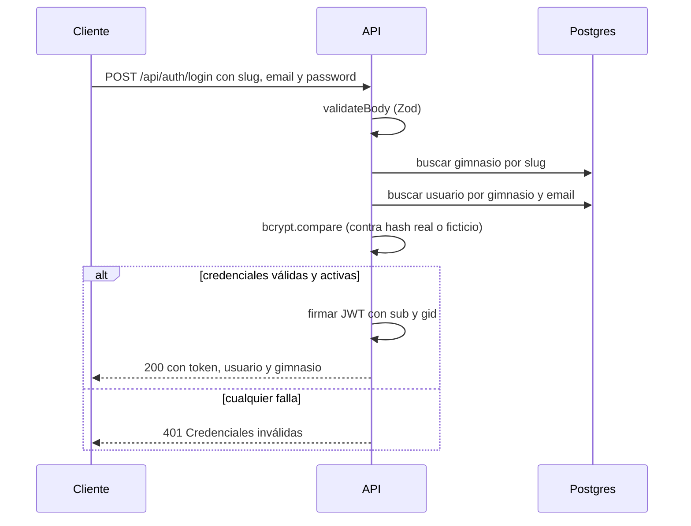
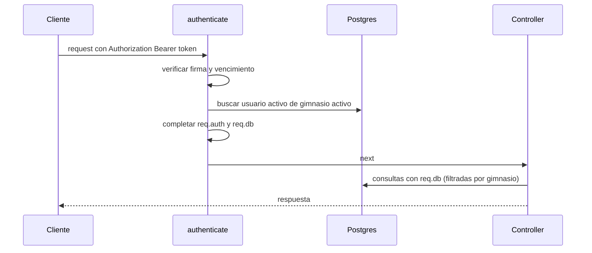

# Autenticación y multi-tenancy (backend)

Documentación del módulo de autenticación de `apps/api`: cómo se registra un gimnasio, cómo se inicia sesión, cómo se protegen las rutas y cómo se garantiza que un gimnasio nunca vea los datos de otro.

**Versiones de referencia:** Express 5.2.1 · Prisma 7.10.0 · Zod 4.6.5 · jsonwebtoken 9.0.3 · bcrypt 6.0.0

---

## 1. Resumen

- FitManager es **multi-tenant**: varios gimnasios comparten la misma base de datos. Cada gimnasio es un *tenant*.
- Las tablas de negocio llevan una columna `gimnasioId`, y toda consulta tiene que filtrar por ella. La excepción temporal es `Horario` (ver sección 14).
- La autenticación usa **JWT** (HS256, 8 horas). El token identifica al usuario y a su gimnasio.
- El filtrado por gimnasio **no se escribe a mano en cada query**: lo hace un cliente de Prisma especial (`req.db`) que agrega el `gimnasioId` automáticamente.
- Hay dos roles: `ADMIN` y `RECEPCIONISTA`. Los profesores y los socios no tienen usuario en el sistema.

---

## 2. Conceptos clave

| Concepto | Qué es |
|---|---|
| **Gimnasio (tenant)** | Un cliente del sistema. Tiene un `slug` único (por ejemplo `fitzone-bahia-blanca`) que lo identifica. |
| **Usuario** | Cuenta del staff de un gimnasio (admin o recepción). El email es único **dentro de cada gimnasio**, no global. |
| **Slug** | Identificador del gimnasio en el login. Más adelante saldrá del subdominio. |
| **`req.auth`** | Datos del usuario autenticado (id, rol, gimnasio). Lo completa `authenticate`. |
| **`req.db`** | Cliente de Prisma limitado al gimnasio del usuario. Lo completa `authenticate`. |

### Por qué el login pide el slug del gimnasio

El mismo email puede existir en dos gimnasios distintos (por ejemplo, alguien que trabaja en ambos). Sin el slug no hay forma de saber a cuál cuenta corresponde la contraseña.

---

## 3. Endpoints

Prefijo común: `/api/auth`

### `POST /api/auth/register-gimnasio`

Crea un gimnasio nuevo y su primer usuario administrador, en una sola transacción: si falla una de las dos cosas, no se crea ninguna.

**Request**

```json
{
  "gimnasio": {
    "nombre": "Gym Test",
    "slug": "gym-test",
    "email": "contacto@gymtest.com",
    "telefono": "291-1234567",
    "direccion": "Av. Colón 123"
  },
  "admin": {
    "nombre": "Ana",
    "apellido": "Test",
    "email": "ana@gymtest.com",
    "password": "password123"
  }
}
```

Los campos `email`, `telefono` y `direccion` del gimnasio son opcionales.

**Respuesta `201`**

```json
{
  "token": "eyJhbGciOi...",
  "usuario": {
    "id": "uuid",
    "email": "ana@gymtest.com",
    "nombre": "Ana",
    "apellido": "Test",
    "rol": "ADMIN"
  },
  "gimnasio": { "id": "uuid", "nombre": "Gym Test", "slug": "gym-test" }
}
```

**Errores:** `400` validación · `409` el slug ya está en uso.

---

### `POST /api/auth/login`

**Request**

```json
{
  "gimnasioSlug": "fitzone-bahia-blanca",
  "email": "admin@fitzone.com",
  "password": "admin123"
}
```

**Respuesta `200`:** misma forma que el registro (`token`, `usuario`, `gimnasio`).

**Errores:** `400` validación · `401` credenciales inválidas.

El `401` usa **siempre el mismo mensaje** (`Credenciales inválidas`), sea que falle el gimnasio, el email, la contraseña o el usuario esté desactivado. Así no se puede averiguar qué emails están registrados.

---

### `GET /api/auth/me`

Devuelve quién es el usuario logueado. Requiere el header `Authorization: Bearer <token>`.

**Respuesta `200`**

```json
{
  "usuario": {
    "id": "uuid",
    "email": "admin@fitzone.com",
    "nombre": "Ana",
    "apellido": "Administradora",
    "rol": "ADMIN"
  },
  "gimnasio": { "id": "uuid", "nombre": "FitZone Bahía Blanca", "slug": "fitzone-bahia-blanca" }
}
```

**Errores:** `401` token ausente, inválido o vencido, o usuario desactivado.

**Para qué sirve:** el frontend lo llama al arrancar para restaurar la sesión después de recargar la página (el estado en memoria se pierde, el token guardado no), para mostrar los datos del usuario y para adaptar la interfaz al rol. Como los datos salen de la base en cada llamada, refleja cambios de rol o desactivaciones al instante.

---

## 4. Reglas de validación

Definidas con Zod en `auth.schema.ts`.

| Campo | Regla |
|---|---|
| `email` | Se recorta y pasa a minúsculas antes de validar. Tiene que ser un email válido. |
| `password` (registro) | Entre 8 y 72 caracteres. El máximo existe porque bcrypt solo considera los primeros 72 bytes. |
| `password` (login) | Solo se exige que no esté vacía, para no bloquear cuentas creadas con reglas anteriores. |
| `slug` | De 3 a 40 caracteres. Solo minúsculas, números y guiones, sin guion al inicio ni al final. |
| `slug` reservados | `www`, `api`, `app`, `admin`, `login`, `static`, `assets` (se van a usar como subdominios). |
| `gimnasio.nombre` | Entre 2 y 100 caracteres. |
| `admin.nombre` / `apellido` | Entre 1 y 60 caracteres. |

Un body inválido responde `400` con este formato:

```json
{
  "error": "Error de validación",
  "details": { "...": "estructura de z.treeifyError" }
}
```

---

## 5. Flujos

### Login



### Request autenticada



---

## 6. JWT

| Propiedad | Valor |
|---|---|
| Algoritmo | `HS256` (se fija al firmar y al verificar) |
| Duración | 8 horas |
| Secreto | Variable de entorno `JWT_SECRET` (validada en `config/env.ts`) |
| Payload | `sub` = id del usuario · `gid` = id del gimnasio · más `iat` y `exp` automáticos |

El token **no incluye el rol ni datos personales**. El rol se lee de la base en cada request (ver `authenticate`), de modo que desactivar a un usuario o cambiarle el rol tiene efecto inmediato y no al vencer el token.

El payload se valida con Zod después de verificar la firma, en vez de confiar en lo que devuelve la librería.

**No hay refresh tokens.** Pasadas las 8 horas el usuario tiene que volver a iniciar sesión, y el cierre de sesión consiste en borrar el token del cliente.

---

## 7. Middlewares

Todos en `src/middlewares/`.

### `authenticate`

1. Exige el header `Authorization: Bearer <token>`.
2. Verifica la firma y el vencimiento del token.
3. Busca en la base al usuario, exigiendo que **él y su gimnasio estén activos**.
4. Completa `req.auth` (usuario, rol, gimnasio) y `req.db` (cliente limitado al gimnasio).

Hace una consulta indexada por request. Es el precio de que las desactivaciones y los cambios de rol sean inmediatos.

### `requireRole(...roles)`

Se usa **después** de `authenticate`. Responde `403` si el rol del usuario no está en la lista.

```ts
router.post("/", requireRole("ADMIN"), crearActividad);
router.get("/", requireRole("ADMIN", "RECEPCIONISTA"), listarActividades);
```

### `validateBody(schema)`

Valida y reemplaza `req.body` con el resultado de Zod (ya normalizado: emails en minúsculas, textos recortados). Si falla, el error llega al `errorHandler` y responde `400`. Solo valida el body: en Express 5, `req.query` es de solo lectura.

---

## 8. Aislamiento por gimnasio (`req.db`)

### Cómo funciona

`tenantClient(gimnasioId)` (en `config/tenant.ts`) devuelve un cliente de Prisma construido con una *Client Extension*. Esa extensión intercepta cada operación y le agrega la condición del gimnasio:

| Operación | Qué hace la extensión |
|---|---|
| `findUnique`, `findFirst`, `findMany`, `count`, `aggregate`, `groupBy`, `delete`, `deleteMany` | Agrega la condición del gimnasio al `where` |
| `update`, `updateMany` | Agrega la condición al `where` y **quita** la columna del gimnasio del `data`, para que nadie mueva un registro a otro gimnasio |
| `create`, `createMany` | Fija `gimnasioId` en `data`, pisando cualquier valor que viniera |
| `upsert` | Combina lo anterior |

La condición se agrega con `AND` y **no reemplaza** lo que ya pidió quien llama. Si se pide un registro de otro gimnasio (por ejemplo `where: { id, gimnasioId: otro }`), las dos condiciones se contradicen y la consulta no encuentra nada.

### Cómo usarlo

```ts
// Lectura: no hace falta filtrar a mano
const socios = await req.db.socio.findMany({ orderBy: { apellido: "asc" } });

// Escritura: gimnasioId se pasa igual (TypeScript lo exige), la extensión lo fuerza al del token
const socio = await req.db.socio.create({
  data: { gimnasioId: req.auth.gimnasioId, nombre, apellido, dni },
});
```

### Tabla de reglas (`TENANT_RULES`)

Cada modelo que se puede usar desde `req.db` tiene un renglón en la tabla `TENANT_RULES` de `config/tenant.ts`, con la columna que lo vincula a su gimnasio y, opcionalmente, las operaciones prohibidas.

| Modelo | Columna de aislamiento | Restricciones |
|---|---|---|
| `Gimnasio` | `id` | Solo se puede **leer y actualizar el propio registro**. `create`, `createMany`, `upsert`, `delete` y `deleteMany` están prohibidos. |
| `Usuario`, `Socio`, `Profesor`, `Actividad`, `ActividadProfesor`, `TipoMembresia`, `Membresia`, `Pago` | `gimnasioId` | Ninguna |
| `Horario` | — (todavía no tiene `gimnasioId`) | **No registrado:** usarlo lanza un error |

Por qué `Gimnasio` tiene esas restricciones: el alta de un gimnasio es el onboarding (que usa el `prisma` global), y un borrado físico arrastraría en cascada todos sus datos. El borrado es siempre lógico, con el campo `activo`.

**La tabla falla cerrado.** Un modelo que no figura en `TENANT_RULES` no se puede usar: la extensión lanza un error en vez de dejar pasar la consulta sin filtro. Así, agregar un modelo y olvidarse de registrarlo no deja datos de otros gimnasios expuestos en silencio.

### Reglas para quien escriba código nuevo

1. **Usá siempre `req.db`, nunca el `prisma` global**, en cualquier código que atienda una request. El `prisma` global no filtra nada. Solo se usa en el módulo `auth` (antes de que exista un usuario autenticado) y en scripts.
2. **Ids escalares, nunca `connect`.** `socioId: "..."` funciona. `socio: { connect: ... }` más el `gimnasioId` que agrega la extensión hace que Prisma rechace la operación.
3. **Validá los ids que lleguen en el body.** Antes de crear algo que referencia a otra entidad (por ejemplo una membresía con un `socioId`), buscala con `req.db`. Si pertenece a otro gimnasio devuelve `null` y respondés `404`.
4. **Evitá `$queryRaw`.** No pasa por la extensión. Si hace falta (por ejemplo en reportes), filtrá por `gimnasioId` a mano.
5. **Los modelos nuevos se registran en `TENANT_RULES` antes de usarse.** Hasta entonces, la extensión lanza un error. Un modelo que no tiene columna `gimnasioId` necesita primero una migración que la agregue.

---

## 9. Errores

| Código | Cuándo | Mensaje |
|---|---|---|
| `400` | Body inválido | `Error de validación` + `details` |
| `401` | Login fallido | `Credenciales inválidas` |
| `401` | Falta el header | `Falta el token de autenticación` |
| `401` | Token mal firmado o vencido | `Token inválido o expirado` |
| `401` | Usuario o gimnasio desactivado, o eliminado | `Usuario inactivo o inexistente` |
| `403` | Rol insuficiente | `No tenés permisos para realizar esta acción` |
| `404` | Registro inexistente o de otro gimnasio (`P2025`) | `Registro no encontrado` |
| `409` | Slug ya usado | `Ese identificador de gimnasio ya está en uso` |
| `409` | Violación de unicidad (`P2002`) | `Ya existe un registro con esos datos` |
| `500` | Operación prohibida o modelo no registrado en `TENANT_RULES` (error de programación, no del usuario) | `Error interno del servidor`. En desarrollo incluye el detalle. |

Para lanzar un error propio desde un service: `throw new AppError(404, "Socio no encontrado")`. En Express 5 no hace falta `try/catch`: los errores de los handlers `async` llegan solos al `errorHandler`.

---

## 10. Decisiones de seguridad

- **Contraseñas con bcrypt**, 10 rondas. Nunca se devuelve el hash: `buildSession` arma la respuesta eligiendo campo por campo.
- **Tiempo de respuesta constante en el login.** Si el usuario no existe, igual se ejecuta `bcrypt.compare` contra un hash ficticio. Sin eso, una respuesta rápida delataría que el email no está registrado.
- **Mensaje único de error** en el login.
- **Algoritmo del JWT fijado** en la verificación, para evitar ataques que lo cambian.
- **Estado verificado en cada request**, no solo al iniciar sesión.
- **Registro en transacción**: gimnasio y admin se crean juntos o no se crea ninguno.
- **Limitación de intentos (recomendada, opcional).** Con `express-rate-limit` se puede limitar `/login` y `/register-gimnasio` (por ejemplo, 20 intentos cada 15 minutos por IP). Al desplegar detrás de un proxy hay que configurar `app.set("trust proxy", 1)`, o todos los usuarios compartirán la misma IP.
- **El aislamiento falla cerrado.** Un modelo sin regla en `TENANT_RULES` y las operaciones prohibidas sobre `Gimnasio` lanzan un error antes de llegar a la base.

---

## 11. Cómo proteger una ruta nueva

```ts
// src/modules/socios/socios.routes.ts
import { Router } from "express";
import { authenticate, requireRole } from "../../middlewares/auth.middleware";
import { validateBody } from "../../middlewares/validate.middleware";
import { crearSocioSchema } from "./socios.schema";
import * as sociosController from "./socios.controller";

export const sociosRouter = Router();

// Todas las rutas de este router requieren sesión
sociosRouter.use(authenticate);

sociosRouter.get("/", sociosController.listar);
sociosRouter.post("/", validateBody(crearSocioSchema), sociosController.crear);
sociosRouter.post("/importar", requireRole("ADMIN"), sociosController.importar);
```

```ts
// src/app.ts
app.use("/api/socios", sociosRouter);
```

Dentro de un controller, `req.auth` y `req.db` están disponibles gracias a `src/types/express.d.ts`. **Solo existen en rutas detrás de `authenticate`**: en cualquier otra, los tipos dicen que están pero valen `undefined`.

---

## 12. Mapa de archivos

```
apps/api/src/
├── config/
│   └── tenant.ts                  Cliente de Prisma con aislamiento por gimnasio
├── middlewares/
│   ├── auth.middleware.ts         authenticate y requireRole
│   ├── validate.middleware.ts     validateBody
│   └── error.middleware.ts        AppError y errorHandler (incluye errores de Prisma)
├── modules/auth/
│   ├── auth.types.ts              Rol y AuthContext
│   ├── auth.schema.ts             Schemas de Zod (registro y login)
│   ├── auth.service.ts            Lógica: registerGimnasio y login
│   ├── auth.controller.ts         Handlers HTTP
│   └── auth.routes.ts             Rutas de /api/auth
├── types/
│   └── express.d.ts               Agrega auth y db a Request
└── utils/
    └── jwt.ts                     signToken y verifyToken
```

---

## 13. Cómo probarlo

Con la API levantada (`npm run dev -w apps/api`) y la base cargada con `npm run db:seed`. El seed crea dos gimnasios, **solo para desarrollo**:

| Gimnasio (slug) | Email | Contraseña | Rol |
|---|---|---|---|
| `fitzone-bahia-blanca` | `admin@fitzone.com` | `admin123` | `ADMIN` |
| `powergym-punta-alta` | `admin@powergym.com` | `admin123` | `ADMIN` |
| `powergym-punta-alta` | `admin@fitzone.com` | `recepcion123` | `RECEPCIONISTA` |

La última fila repite el email de la primera en otro gimnasio: sirve para comprobar que el email es único por gimnasio, no global.

```bash
# Login
curl -s -X POST http://localhost:3000/api/auth/login \
  -H "Content-Type: application/json" \
  -d '{"gimnasioSlug":"fitzone-bahia-blanca","email":"admin@fitzone.com","password":"admin123"}'

# Usuario actual
curl -s http://localhost:3000/api/auth/me -H "Authorization: Bearer <TOKEN>"

# Registrar otro gimnasio
curl -s -X POST http://localhost:3000/api/auth/register-gimnasio \
  -H "Content-Type: application/json" \
  -d '{"gimnasio":{"nombre":"Gym Test","slug":"gym-test"},"admin":{"nombre":"Ana","apellido":"Test","email":"ana@gymtest.com","password":"password123"}}'

  # Mismo email, otro gimnasio: devuelve rol RECEPCIONISTA
curl -s -X POST http://localhost:3000/api/auth/login \
  -H "Content-Type: application/json" \
  -d '{"gimnasioSlug":"powergym-punta-alta","email":"admin@fitzone.com","password":"recepcion123"}'

# La contraseña de FitZone contra PowerGym: 401
curl -s -X POST http://localhost:3000/api/auth/login \
  -H "Content-Type: application/json" \
  -d '{"gimnasioSlug":"powergym-punta-alta","email":"admin@fitzone.com","password":"admin123"}'
```

**Prueba de aislamiento.** Con los dos gimnasios del seed, un script temporal (`apps/api/scripts/check-tenant.ts`, que no se commitea) crea un socio en cada uno y comprueba que el gimnasio A no puede leer, modificar ni borrar datos del B. Son nueve comprobaciones y todas tienen que dar `true`:

- Cuatro sobre `Socio`: ver solo los propios, no leer, no modificar y no borrar los del otro gimnasio.
- Tres sobre `Gimnasio`: ver solo el propio, no leer y no modificar el de otro.
- Una que confirma que borrar gimnasios desde `req.db` está prohibido.
- Una que confirma que `Horario` está bloqueado.

Se reemplaza por tests automáticos en el epic de testing, y el test de aislamiento entre gimnasios es el más importante del proyecto.

---

## 14. Límites conocidos y pendientes

| Tema | Detalle | Cuándo se resuelve |
|---|---|---|
| `Horario` sin aislamiento | La tabla no tiene `gimnasioId`. Hasta resolverlo, `req.db.horario` lanza un error porque el modelo no está en `TENANT_RULES`, así que no se puede usar por accidente. | Epic 3: se agrega la columna con una migración y se registra en `TENANT_RULES`. |
| Consultas raw | `$queryRaw` ignora la extensión. | Regla de equipo (sección 8). |
| Sin refresh tokens | El token dura 8 horas y no se puede revocar individualmente antes de que venza. Sí se corta el acceso desactivando al usuario, porque `authenticate` lo verifica en cada request. | Se reevalúa si hace falta. |
| Recuperación de contraseña | No implementada. | Epic 1 (opcional) o junto con las notificaciones por mail del Epic 6. |
| Gestión de usuarios del staff | Alta, baja y cambio de rol todavía no tienen endpoints. | Epic 1. |
| Almacenamiento del token en el frontend | Sin definir. | Epic 1, parte de frontend. |
