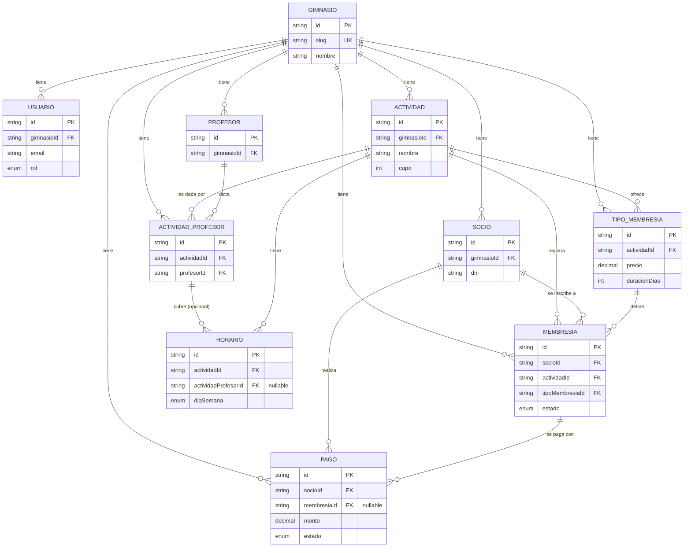

## Modelo de datos

### Diagrama de relaciones

### Multi-tenancy

Todas las tablas principales tienen una columna `gimnasioId` que las vincula a un `Gimnasio` (el tenant). Es la base del aislamiento entre gimnasios distintos en la misma base de datos compartida — **toda query debe filtrar por `gimnasioId`**, inyectado automáticamente por el middleware de resolución de tenant (Epic 2). Ninguna tabla de negocio queda sin este campo.

### Relaciones explicadas

**`Gimnasio` → todo**
Es la raíz del árbol de tenant. Tiene `onDelete: Cascade` hacia casi todas sus relaciones — borrar un gimnasio borra toda su data. En la práctica, un gimnasio nunca se borra físicamente; se desactiva con el campo `activo`.

**`Actividad` ↔ `Profesor` (muchos a muchos, vía `ActividadProfesor`)**
Una actividad puede tener varios profesores, y un profesor puede dar varias actividades. `ActividadProfesor` es la tabla intermedia que resuelve esa relación — cada fila es "este profesor da esta actividad". Tiene un `@@unique([actividadId, profesorId])` para que no se pueda vincular el mismo profesor dos veces a la misma actividad.

**`Horario` → `Actividad` (obligatorio) y → `ActividadProfesor` (opcional)**
Un horario siempre pertenece a una actividad. Opcionalmente, puede estar asociado a un vínculo `ActividadProfesor` puntual — esto permite que un horario tenga un profesor específico asignado (ej: "lunes 18hs, da Carlos") o que quede "general", sin profesor fijo (`actividadProfesorId: null`). La base no valida por sí sola que el profesor asignado a un horario realmente dé esa actividad en particular — esa consistencia (`actividadProfesor.actividadId === horario.actividadId`) se valida a nivel de service.

**`TipoMembresia` → `Actividad`**
Los tipos de membresía son específicos de cada actividad, no genéricos del gimnasio. "Mensual" en Musculación y "Mensual" en Jiujitsu son dos registros distintos, con su propio precio y duración — así cada actividad se maneja comercialmente por separado.

**`Membresia` = inscripción de un socio a una actividad puntual**
Vincula `Socio` + `Actividad` + `TipoMembresia`, con su propio `fechaInicio`/`fechaFin`/`estado`. Un socio puede tener varias membresías activas en paralelo (una por actividad distinta — ej: musculación y jiujitsu al mismo tiempo), pero como máximo una activa por `(socio, actividad)`. Esa restricción **no está forzada a nivel de base de datos** (Prisma no soporta fácil un índice único condicional por `estado`); se valida en el service antes de crear una membresía nueva.

**`Pago` → `Socio` (obligatorio) y → `Membresia` (opcional)**
Todo pago pertenece a un socio. Opcionalmente puede estar asociado a una membresía específica (el caso normal: "pagó la cuota de jiujitsu"). Queda `null` para pagos sueltos que no corresponden a ninguna membresía puntual (ej: venta de un producto, un servicio adicional) — en ese caso se usa el campo `concepto` para describir de qué se trata.

**`Usuario` — separado de `Socio` y de `Profesor`**
`Usuario` son las cuentas que loguean al sistema (admin, recepción) — no tiene relación con `Socio` ni con `Profesor`, que son solo registros de datos administrativos sin acceso al sistema (confirmado que los profesores no van a tener login).

### Convenciones generales

- **Soft delete, no hard delete:** casi todas las entidades de negocio tienen un campo `activo` (o `estado` en el caso de `Membresia`/`Pago`). El borrado físico (`DELETE`) se reserva para limpieza de datos de test, nunca para el flujo normal de la app.
- **Montos en `Decimal`, nunca `Float`:** evita errores de redondeo binario en cálculos de dinero.
- **IDs como UUID:** en vez de autoincrementales, para no filtrar información de volumen de datos entre tenants y facilitar merges/migraciones futuras.