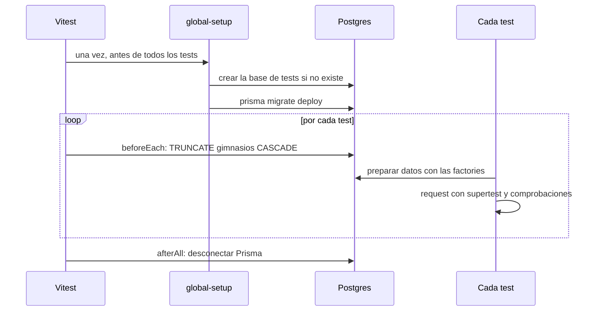

# Testing (backend)

Documentación de la suite de tests de `apps/api`: cómo correrla, cómo funciona por dentro, cómo escribir tests nuevos y qué protege.

**Versiones de referencia:** Vitest 5.1.0 · supertest 7 · PostgreSQL 16 · Prisma 7.10.0 · Express 5.2.1 · Node ≥ 22.12

---

## 1. Resumen

- Los tests son **de integración y corren contra un PostgreSQL real**, no contra mocks. El aislamiento entre gimnasios (la garantía más importante del sistema) solo se puede comprobar con una base de datos de verdad: un mock repetiría lo que el código ya supone.
- Cada test levanta la API real (`createApp()`), le manda requests con **supertest** y verifica tanto la respuesta HTTP como el **estado de la base**.
- Hay una **base de datos aparte para los tests** (`fitmanager_dev_test`). La de desarrollo nunca se toca, y hay una protección que cancela la corrida si alguna vez apuntara a otra base.
- Cada test arranca con la base **vacía** y crea los datos que necesita con funciones de ayuda (*factories*).
- Al momento de escribir este documento hay **119 tests en 6 archivos**, que tardan unos 20 segundos.

---

## 2. Correr los tests

Requisito: Postgres levantado (`npm run db:up`).

```bash
# Toda la suite (desde la raíz del repo)
npm test

# Modo observador: re-ejecuta los tests afectados al guardar un archivo
npm run test:watch -w apps/api

# Chequeo de tipos de código y tests
npm run typecheck -w apps/api
```

Para correr una parte, ubicate en `apps/api`:

```bash
cd apps/api
npx vitest run tests/integration/auth.test.ts          # un archivo
npx vitest run -t "desactivado"                        # los tests cuyo nombre contenga ese texto
```

**La primera vez** la suite crea sola la base `fitmanager_dev_test` y le aplica las migraciones. Las corridas siguientes solo aplican las migraciones nuevas, si las hay. No hace falta preparar nada a mano.

Si cambiás `schema.prisma`, creá la migración como siempre (`npm run db:migrate`): la próxima corrida de tests la aplica sola.

---

## 3. Cómo funciona

### La base de tests

El nombre de la base de tests se deriva de la de desarrollo agregándole el sufijo `_test`:

| `DATABASE_URL` en `apps/api/.env` | Base de tests |
|---|---|
| `.../fitmanager_dev?schema=public` | `.../fitmanager_dev_test?schema=public` |

Mismo servidor, mismo usuario y mismo puerto, pero otra base. En CI no hay `.env`, así que se define la variable `TEST_DATABASE_URL` y se usa tal cual.

### Protección contra borrar datos reales

Los tests vacían tablas. Por eso hay una verificación (`assertTestDatabase`, en `tests/test-env.ts`) que **cancela la corrida si el nombre de la base no termina en `_test`**. Se ejecuta en dos momentos: al preparar la base y **antes de cada truncado**. Si alguien configura mal las variables de entorno, los tests fallan con un mensaje claro en lugar de borrar la base de desarrollo.

### Ciclo de una corrida



### Piezas de configuración

| Archivo | Qué hace |
|---|---|
| `vitest.config.mts` | Configuración de Vitest. Los archivos de test corren **de a uno** (`fileParallelism: false`) porque comparten la base. Es `.mts` porque Vite avisa que dejará de aceptar sintaxis ESM en un paquete CommonJS. |
| `tests/test-env.ts` | Calcula la URL de la base de tests y contiene la protección `assertTestDatabase`. |
| `tests/global-setup.ts` | Se ejecuta una vez: crea la base si no existe (conectándose a la base de mantenimiento `postgres`) y corre `prisma migrate deploy` sobre ella. |
| `tests/env.ts` | Fija `NODE_ENV`, `DATABASE_URL` y `JWT_SECRET` **antes** de que se cargue código de la API, porque `config/env.ts` valida las variables apenas se importa. |
| `tests/setup.ts` | Antes de cada test vacía la base; al terminar cada archivo desconecta Prisma. |
| `tests/helpers/db.ts` | `resetDb()`: `TRUNCATE "gimnasios" CASCADE`. Todas las tablas dependen, directa o indirectamente, de `gimnasios`, así que una sola sentencia vacía todo. |

El orden de `setupFiles` importa: `env.ts` tiene que ir antes que `setup.ts`.

En los tests el logger está en modo `silent` (ver `config/logger.ts`), para que el ruido de cada request no tape los resultados.

---

## 4. Estructura y cobertura

```
apps/api/
├── vitest.config.mts
└── tests/
    ├── env.ts · test-env.ts · global-setup.ts · setup.ts     configuración
    ├── helpers/
    │   ├── db.ts              resetDb
    │   └── factories.ts       datos de prueba
    ├── integration/           contra Postgres real
    │   ├── tenant.test.ts          32 tests
    │   ├── auth.test.ts            41 tests
    │   ├── usuarios.test.ts        35 tests
    │   ├── login-timing.test.ts     3 tests
    │   └── app.test.ts              5 tests
    └── unit/
        └── rate-limit.test.ts       3 tests
```

| Archivo | Qué comprueba |
|---|---|
| `tenant.test.ts` | El aislamiento de `req.db`: cada operación de Prisma (`findMany`, `findUnique`, `update`, `delete`, `upsert`, `groupBy`…) sobre el modelo `Socio`; las restricciones de `Gimnasio`; el bloqueo de `Horario`; `include` de relaciones; transacciones; y la limitación conocida de las consultas raw. |
| `auth.test.ts` | Registro de gimnasios, login, `/me`, validación de tokens y cambio de contraseña. |
| `usuarios.test.ts` | Gestión del personal: acceso por rol, listado, alta, actualización, reglas del administrador y reseteo de contraseña. |
| `login-timing.test.ts` | Que el login ejecuta `bcrypt` aunque el usuario no exista (ver sección 7). |
| `app.test.ts` | `/health`, rutas inexistentes, JSON mal formado, cuerpo demasiado grande y headers de helmet. |
| `rate-limit.test.ts` | El límite de intentos: 20 por ventana en producción, sin molestar en desarrollo ni en tests. |

---

## 5. Helpers de datos (`tests/helpers/factories.ts`)

Las factories crean registros reales en la base de tests. Todas las contraseñas de prueba son `PASSWORD` (`clave-test-123`), y el hash se calcula una sola vez porque `bcrypt` es lento a propósito.

| Función | Qué crea |
|---|---|
| `crearGimnasio(datos?)` | Un gimnasio. Acepta `nombre`, `slug` y `activo`. |
| `crearUsuario(gimnasioId, datos?)` | Un usuario (`RECEPCIONISTA` por defecto). Acepta `email`, `nombre`, `apellido`, `rol`, `activo` y `password` (para uno con contraseña distinta de `PASSWORD`). |
| `crearSocio(gimnasioId, datos?)` | Un socio con DNI único. |
| `crearActividadConHorario(gimnasioId)` | Una actividad con un horario. |
| `crearEscenario()` | **Dos gimnasios, cada uno con un administrador y su token.** Es el punto de partida de casi todos los tests de aislamiento: devuelve `{ a, b }` y cada lado tiene `gimnasio`, `admin` y `token`. |
| `tokenDe(usuario)` | Un token válido, sin pasar por el login. |
| `conToken(token)` | El header `{ Authorization: "Bearer ..." }` listo para `.set(...)`. |

Un test típico:

```ts
const { a, b } = await crearEscenario();
const socio = await crearSocio(b.gimnasio.id);

const res = await request(app).get(`/api/socios/${socio.id}`).set(conToken(a.token));

expect(res.status).toBe(404); // el gimnasio A no ve datos del B
```

---

## 6. Cómo escribir un test nuevo

### Convenciones

- Los archivos se llaman `<tema>.test.ts` y van en `tests/integration/` (si usan la base) o `tests/unit/` (si no).
- Los nombres de los tests **describen el comportamiento** en español, no la implementación: `"un usuario desactivado pierde el acceso en el acto"`, no `"test del middleware"`.
- **Un comportamiento por test.** Si el nombre necesita una "y", probablemente son dos tests.
- Cada test es independiente: arranca con la base vacía y crea sus propios datos. Ningún test depende de otro ni del orden.
- Para entrar como usuario se usa `tokenDe(...)`. Solo los tests del login usan el endpoint de login.
- Se verifica **el efecto en la base**, no solo el código HTTP. Un `404` que además modificó un registro ajeno sería un bug que el status solo no muestra.
- Se usa el `prisma` global **solo en los tests**, para preparar y comprobar datos. El código de la API sigue usando `req.db`.

### Qué tiene que probar todo endpoint nuevo

| # | Caso | Ejemplo |
|---|---|---|
| 1 | Sin sesión | `401` |
| 2 | Rol insuficiente (si el endpoint restringe por rol) | `403` y sin efectos |
| 3 | Datos inválidos | `400`, y no se guardó nada |
| 4 | Camino feliz | La respuesta correcta **y** el cambio en la base |
| 5 | **Aislamiento:** el recurso es de otro gimnasio | `404`, y el registro ajeno **no se modificó** |

El quinto es el que no se puede omitir: es el que protege el multi-tenancy.

### Plantilla para un módulo nuevo (ejemplo: socios)

```ts
import request from "supertest";
import { describe, expect, it } from "vitest";
import { createApp } from "../../src/app";
import { prisma } from "../../src/config/database";
import { conToken, crearEscenario, crearSocio } from "../helpers/factories";

const app = createApp();

describe("GET /api/socios", () => {
  it("exige sesión", async () => {
    const res = await request(app).get("/api/socios");
    expect(res.status).toBe(401);
  });

  it("lista solo los socios del propio gimnasio", async () => {
    const { a, b } = await crearEscenario();
    const propio = await crearSocio(a.gimnasio.id);
    await crearSocio(b.gimnasio.id);

    const res = await request(app).get("/api/socios").set(conToken(a.token));

    expect(res.status).toBe(200);
    expect(res.body.map((s: { id: string }) => s.id)).toEqual([propio.id]);
  });
});

describe("PATCH /api/socios/:id", () => {
  it("responde 404 para un socio de otro gimnasio y no lo modifica", async () => {
    const { a, b } = await crearEscenario();
    const ajeno = await crearSocio(b.gimnasio.id);

    const res = await request(app)
      .patch(`/api/socios/${ajeno.id}`)
      .set(conToken(a.token))
      .send({ nombre: "HACK" });

    expect(res.status).toBe(404);
    const intacto = await prisma.socio.findUniqueOrThrow({ where: { id: ajeno.id } });
    expect(intacto.nombre).toBe(ajeno.nombre);
  });
});
```

Cuando se agrega un modelo nuevo con `gimnasioId`, hay que registrarlo en `TENANT_RULES` (`config/tenant.ts`) y sumar tests de aislamiento en `tenant.test.ts`, como los de `Socio`.

---

## 7. Técnicas usadas en la suite

| Técnica | Dónde | Para qué |
|---|---|---|
| `supertest` sobre `createApp()` | Todos los tests HTTP | Probar las rutas reales sin abrir un puerto. |
| Token directo con `tokenDe` | `usuarios.test.ts`, `auth.test.ts` | No depender del login para entrar. |
| Tokens falsificados con `jsonwebtoken` | `auth.test.ts` | Vencido, firmado con otro secreto, algoritmo `none`, sin `sub` ni `gid`, y con el `gid` de otro gimnasio. |
| `it.each` | `auth.test.ts`, `usuarios.test.ts`, `tenant.test.ts` | Probar la misma regla con varios datos inválidos. |
| `Promise.all` | `usuarios.test.ts` | Provocar una **carrera**: dos altas simultáneas con el mismo email. Verifica que una se crea y la otra recibe `409` (el camino del error `P2002`). |
| Mock parcial con `vi.mock` | `login-timing.test.ts` | Envolver `comparePassword` para observar con qué hash se la llama, sin cambiar su comportamiento. |
| `vi.stubEnv` + `vi.resetModules` | `rate-limit.test.ts` | El límite se decide al cargar el módulo según `NODE_ENV`: se recarga el módulo con cada entorno. |

### Por qué `login-timing.test.ts` no mide tiempos

Si el usuario no existe y no se hiciera ninguna comparación, el login respondería mucho más rápido y delataría qué emails están registrados. Un test de tiempos sería frágil (depende de la máquina y de la carga). En cambio, el test comprueba el mecanismo: que `bcrypt` se ejecuta **igual** contra un hash válido de formato bcrypt, exista o no el usuario.

---

## 8. Cómo sabemos que los tests detectan fallas

Un test que pasa no prueba que sirva: también tiene que **fallar cuando el código se rompe**. Para validar la suite se hizo una *prueba de mutación manual*: se rompió el código a propósito de once maneras y se comprobó que algún test fallara.

| Rotura introducida | Archivo que la detecta |
|---|---|
| El filtro por gimnasio deja de aplicarse | `tenant.test.ts` (17 tests fallan) |
| `Gimnasio` deja de prohibir crear y borrar | `tenant.test.ts` |
| Un modelo sin registrar pasa sin filtro | `tenant.test.ts` |
| Un `update` puede mover un registro a otro gimnasio | `tenant.test.ts` |
| No se verifica que el usuario esté activo | `auth.test.ts` |
| No se cruza el gimnasio del token con el del usuario | `auth.test.ts` |
| Un admin puede desactivarse a sí mismo | `usuarios.test.ts` |
| El reseteo de contraseña usa el `prisma` global | `usuarios.test.ts` |
| El límite de producción sube de 20 a 1000 | `rate-limit.test.ts` |
| El login no compara contra el hash ficticio | `login-timing.test.ts` |
| Un JSON mal formado vuelve a dar `500` | `app.test.ts` |

**Para validar un test nuevo**, hacé lo mismo a mano: rompé temporalmente el código que debería proteger (por ejemplo, comentá el chequeo de rol), corré el test y comprobá que falle. Después restaurá el código. Un test que pasa tanto con el código sano como con el roto no está probando nada.

Este mismo proceso encontró un bug real: un JSON mal formado respondía `500` en lugar de `400`.

---

## 9. Integración continua

El workflow `.github/workflows/ci.yml` tiene un job **"Tests"**, separado de "Lint y build":

- Levanta un **servicio de Postgres 16** (`postgres:16-alpine`) dentro del job.
- Genera el cliente de Prisma (con una `DATABASE_URL` ficticia, porque generar no se conecta a nada).
- Define `TEST_DATABASE_URL` apuntando a `fitmanager_test` y ejecuta `npm test`. La propia suite crea esa base y le aplica las migraciones.

El check **"Tests"** debe figurar entre los obligatorios del ruleset de `main`, igual que "Lint y build".

---

## 10. TypeScript y compatibilidad

- `apps/api/tsconfig.json` incluye `src` y `tests`, y **no define opciones de emisión**. `tsconfig.build.json` extiende ese archivo, agrega `rootDir` y `outDir` y limita `include` a `src`: por eso el build compilado no incluye tests.
- Se usa `module: nodenext` porque `moduleResolution: node` está deprecado en TypeScript 6. La configuración compila sin errores en TypeScript 5.9, 6.0 y 7.0.
- Con `nodenext`, el `import()` **dinámico** necesita extensión (`"../../src/middlewares/rate-limit.middleware.js"`). Los `import` estáticos no.
- Los tests no pueden usar `import.meta` (el paquete es CommonJS): usá `__dirname` si necesitás una ruta.
- Vitest 5 requiere **Node ≥ 22.12**. Las versiones 4.1.x de Vitest no se instalan con npm 10.9.7 (el que trae Node 22): fallan con `Cannot read properties of null (reading 'edgesOut')`.

---

## 11. Limitaciones conocidas

| Tema | Detalle |
|---|---|
| Los archivos corren de a uno | Comparten una sola base y el truncado afectaría a los otros. Si la suite crece mucho, se puede dar un esquema por proceso. |
| Consultas raw | `$queryRaw` no pasa por el aislamiento. Un test lo documenta con el nombre `"las consultas raw NO están aisladas"`: si algún día se protege, va a fallar y habrá que actualizar `auth.md`. |
| `Horario` | Está bloqueado en `req.db` porque todavía no tiene `gimnasioId`. Cuando se agregue y se registre en `TENANT_RULES`, hay que **reemplazar** el test `"Horario está bloqueado hasta que tenga gimnasioId"` por tests de aislamiento. |
| Tiempos | No se miden; se verifica el mecanismo (sección 7). |
| Frontend | Todavía no tiene tests. |
| Cobertura | No se mide ni hay un mínimo exigido. Se puede agregar más adelante con `@vitest/coverage-v8`. |

---

## 12. Problemas frecuentes

| Síntoma | Causa probable | Solución |
|---|---|---|
| `ECONNREFUSED` al empezar | Postgres no está levantado | `npm run db:up` y verificar con `docker compose ps` |
| `Los tests solo pueden correr contra una base cuyo nombre termine en "_test"` | `DATABASE_URL` o `TEST_DATABASE_URL` mal configuradas | Revisar `apps/api/.env` y que no haya un `TEST_DATABASE_URL` apuntando a otra base |
| `permission denied to create database` | El usuario de Postgres no puede crear bases | Con el Docker del proyecto no pasa (el usuario es superusuario); si usás otro servidor, crear `fitmanager_dev_test` a mano |
| La autenticación falla contra el puerto 5432 en Windows | Un Postgres nativo ocupa el puerto | Usar `POSTGRES_PORT=5433` (ver el README) |
| Fallan tests que usan un modelo o campo nuevo | El cliente de Prisma no está regenerado | `npm run prisma:generate -w apps/api` |
| Hay que recrear la base de tests desde cero | Por ejemplo, tras editar una migración (no debería pasar) | `docker exec -it fitmanager-db psql -U fitmanager -d postgres -c "DROP DATABASE fitmanager_dev_test"` y volver a correr los tests |
| Vite avisa de "ESM syntax in a file loaded as CommonJS" | El config de Vitest es `.ts` | Tiene que llamarse `vitest.config.mts` |
| `Cannot find module` en un `import()` de un test | Falta la extensión `.js` en un import dinámico | Agregarla (ver sección 10) |
| La suite no termina y queda esperando | Se ejecutó el modo observador | `npm test` usa `vitest run`; el modo observador es `test:watch` |
| `Vitest requires Node >= 22.12` o errores raros al instalar | Node 20 | Usar Node 22 (ver `.nvmrc`) |

---

## 13. Antes de abrir un Pull Request

```bash
npm run lint
npm run format:check
npm run typecheck -w apps/api
npm test
```

El CI ejecuta los mismos pasos. Si agregaste o cambiaste un endpoint, confirmá que tenés los cinco casos de la sección 6, en especial el de **aislamiento entre gimnasios**.
