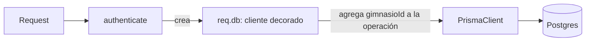

# Decisiones de diseño — FitManager

**Alcance del análisis:** backend (`apps/api`): Express 5, Prisma 7, Zod 4, PostgreSQL. El frontend todavía no se implemento.

Este documento sigue la estructura que pide la consigna. Después de un inventario general de patrones, presenta tres análisis, cada uno con las cinco secciones obligatorias: código analizado, diagnóstico, alternativas, decisión y evidencia con trade-offs. El **Análisis 1** es el análisis profundo.

## Índice

1. [Inventario de patrones de diseño](#1-inventario-de-patrones-de-diseño)
2. [Análisis 1 — Aislamiento multi-tenant](#2-análisis-1--aislamiento-multi-tenant-configtenantts)
3. [Análisis 2 — Capa de servicio y dependencias del módulo `auth`](#3-análisis-2--capa-de-servicio-y-dependencias-del-módulo-auth)
4. [Análisis 3 — El script `seed.ts`](#4-análisis-3--el-script-seedts)
5. [SOLID en el proyecto](#5-solid-en-el-proyecto)
6. [Code smells detectados](#6-code-smells-detectados)
7. [Clean Code: criterios adoptados](#7-clean-code-criterios-adoptados)
8. [Oportunidades de patrones por epic](#8-oportunidades-de-patrones-por-epic)
9. [Estado de las decisiones](#9-estado-de-las-decisiones)

---

## 1. Inventario de patrones de diseño

Distinguimos tres niveles:

- **Aplicado:** lo escribimos nosotros.
- **Aportado por una librería o por el runtime:** lo usamos, pero no lo implementamos.
- **Candidato:** todavía no existe; se evalúa en la sección 8.

### Creacionales

| Patrón | Nivel | Dónde | Comentario |
|---|---|---|---|
| Singleton | Aplicado | `config/database.ts` (`prisma`), `config/env.ts` (`env`), `config/logger.ts` (`logger`) | Se logra con la caché de módulos de Node: no hay clase ni `getInstance()`. Todo el proceso comparte una instancia (un solo pool de conexiones). Costo: es difícil reemplazarla en tests (ver Análisis 2). |
| Factory (función fábrica) | Aplicado | `createApp()` en `app.ts`; `tenantClient(gimnasioId)` en `config/tenant.ts`; `validateBody(schema)` y `requireRole(...roles)` en `middlewares/` | Cada una construye un objeto o función configurada según sus parámetros. No es el Factory Method de GoF (no hay jerarquía de creadores): es una función fábrica simple. |
| Builder | Candidato | `prisma/seed.ts` y tests futuros | Ver Análisis 3. |

### Estructurales

| Patrón | Nivel | Dónde | Comentario |
|---|---|---|---|
| Decorator | Aplicado | `config/tenant.ts` | La Client Extension de Prisma envuelve cada operación, le agrega el filtro por gimnasio y conserva la misma interfaz. Es el eje del Análisis 1. |
| Adapter | Librería + candidato | `PrismaPg` en `config/database.ts` | Adapta el driver `pg` a la interfaz que espera Prisma 7. Candidatos propios: envolver el SDK de Mercado Pago y el proveedor de mails. |
| Facade | Aplicado, parcial | `modules/auth/auth.service.ts` | `login` y `registerGimnasio` ocultan bcrypt, JWT, transacción y consultas. Es más una capa de servicio que una Facade pura. |

### De comportamiento

| Patrón | Nivel | Dónde | Comentario |
|---|---|---|---|
| Observer | Runtime + candidato | `process.on("SIGINT")` / `process.on("SIGTERM")` en `server.ts` | Usa el `EventEmitter` de Node. Como candidato propio: eventos de dominio (por ejemplo, "pago registrado"). |
| Strategy | Candidato | Métodos de pago, cálculo de vencimiento, formatos de reporte | Sección 8. |
| Command | No aplica | — | No hay necesidad real en el proyecto. |

---

## 2. Análisis 1 — Aislamiento multi-tenant (`config/tenant.ts`)

### 2.1 Código analizado

- `apps/api/src/config/tenant.ts`: `tenantClient`, `scopeArgs`, `scopeWhere`, `scopeData`, `protectData` y la constante `TENANT_MODELS`.
- `apps/api/src/middlewares/auth.middleware.ts`: donde se construye `req.db = tenantClient(gimnasioId)`.
- `apps/api/prisma/schema.prisma`: modelos con y sin columna `gimnasioId`.
- `apps/api/scripts/check-tenant.ts`: script de verificación manual.



### 2.2 Diagnóstico

**Problema de negocio.** FitManager es multi-tenant con base compartida: un gimnasio nunca debe ver ni modificar los datos de otro. El riesgo principal es el error humano: bastaría olvidar un `where: { gimnasioId }` en una sola consulta para filtrar datos entre clientes.

**Patrones aplicados.**

- **Decorator:** la Client Extension intercepta cada operación de Prisma, modifica sus argumentos y delega en el cliente original. La interfaz que ve el resto del código no cambia.
- **Factory:** `tenantClient(gimnasioId)` produce un cliente distinto por request.

**Code smells y problemas de diseño detectados.**

| # | Hallazgo | Concepto |
|---|---|---|
| 1 | `scopeArgs` es un `switch` sobre el nombre de la operación. Cada operación nueva de Prisma obliga a revisar el `switch`. | Smell *Switch Statements* · Principio abierto/cerrado (OCP) |
| 2 | `TENANT_MODELS` es una lista escrita a mano. Si se agrega un modelo y se olvida sumarlo, queda sin protección en silencio. **Ya pasó con `Horario`**, que no tiene `gimnasioId`. | Conocimiento duplicado (schema y lista) · OCP |
| 3 | `Gimnasio` no está en la lista, y `req.db` expone todos los modelos. Según cómo está escrito el código, `req.db.gimnasio.findMany()` devolvería **todos** los gimnasios. | Principio de segregación de interfaces (ISP) · mínimo privilegio |
| 4 | `req.db` también expone `$queryRaw`, que no pasa por la extensión. | ISP · mínimo privilegio |
| 5 | Un mismo archivo define la política (qué modelos), la transformación de argumentos y la construcción del cliente. | Principio de responsabilidad única (SRP), leve |
| 6 | Los tipos de TypeScript no reflejan la inyección: en un `create` hay que pasar `gimnasioId` aunque la extensión lo fuerce. | Costo conocido del diseño |

### 2.3 Alternativas

| Opción | Descripción | A favor | En contra |
|---|---|---|---|
| **A** | Filtrar a mano en cada consulta (`where: { gimnasioId }`) | Explícito, sin "magia" | Repetición en todo el código (viola DRY). Un olvido es una fuga de datos. |
| **B** | Una clase Repository por entidad, con `gimnasioId` en el constructor | Encapsula el acceso a datos | Muchas clases casi idénticas. Nada impide usar Prisma directamente y saltearse el repositorio. |
| **C** | *Row Level Security* de PostgreSQL con políticas por tenant | La base garantiza el aislamiento, incluso para consultas raw | Hay que fijar una variable de sesión por transacción (complica el pool de conexiones con Prisma), exige migraciones SQL y es más difícil de depurar para un equipo de cuatro con poco tiempo. |
| **D** | Un schema o una base por gimnasio | Aislamiento fuerte | Cada migración se aplica N veces. No escala para muchos gimnasios chicos. |
| **E** | **Client Extension (Decorator), la solución actual** | Una sola implementación, imposible de olvidar en consultas normales, bajo costo | Comportamiento implícito. Tiene los hallazgos de la sección anterior. |

### 2.4 Decisión

**Mantener la opción E** y corregir los hallazgos, sin migrar a RLS en esta etapa.

**Por qué.** Resuelve el riesgo central (el olvido humano) de forma centralizada. Es verificable con el script `check-tenant.ts` y, más adelante, con tests. Y el equipo puede entenderla y mantenerla. RLS queda como **defensa en profundidad** para una etapa posterior, porque cubriría los casos que la extensión no ve (consultas raw).

**Cambios decididos.**

1. Tratar a `Gimnasio` como caso especial: desde `req.db` solo se puede acceder al propio registro (`where: { id: gimnasioId }`). Hallazgo 3. *Estado: pendiente.*
2. Reemplazar la lista `TENANT_MODELS` por una tabla `modelo → campo que lo vincula al tenant`. Agregar un modelo pasa a ser agregar una fila, y el caso de `Gimnasio` (campo `id`) entra sin condicionales especiales. Hallazgos 1 y 2, aplicando *Replace Conditional with Lookup Table*. *Estado: pendiente.*

   ```ts
   const TENANT_FIELD: Record<string, string> = {
     Gimnasio: "id",
     Usuario: "gimnasioId",
     Socio: "gimnasioId",
     // ...un renglón por modelo
   };
   ```

3. Agregar `gimnasioId` a `Horario` y sumarlo a la tabla. Hallazgo 2. *Estado: pendiente; está planificado para el Epic 3.*
4. Mantener la regla de equipo: **no usar `$queryRaw` ni el `prisma` global en código que atienda requests**. Hallazgo 4. *Estado: documentado en `docs/auth.md`.*
5. Dejar sin cambios los hallazgos 5 y 6. El archivo tiene unas 90 líneas y cada función es corta, así que dividirlo sería overengineering. Y el requisito de pasar `gimnasioId` en los `create` es un costo aceptable: hace explícito el dato y la extensión lo fuerza igual.

### 2.5 Evidencia y trade-offs

**Evidencia.**

- Implementación: `apps/api/src/config/tenant.ts`.
- Uso: `apps/api/src/middlewares/auth.middleware.ts`, línea `req.db = tenantClient(gimnasioId)`.
- Verificación: `apps/api/scripts/check-tenant.ts` comprueba que un gimnasio no puede leer, modificar ni borrar datos de otro.

**Beneficios.**

- Seguridad por defecto: los servicios no escriben el filtro.
- Un único punto para corregir o auditar la regla.
- Menos código en cada módulo.

**Costos.**

- La regla es implícita: quien lee un servicio no ve el filtro. Se mitiga documentándolo y con el script de verificación.
- Las consultas raw quedan fuera.
- Cada request crea un cliente extendido. Prisma lo define como una operación liviana, pero no es gratis.

---

## 3. Análisis 2 — Capa de servicio y dependencias del módulo `auth`

### 3.1 Código analizado

- `apps/api/src/modules/auth/`: `auth.routes.ts`, `auth.controller.ts`, `auth.service.ts`, `auth.schema.ts`, `auth.types.ts`.
- `apps/api/src/utils/jwt.ts`.
- `apps/api/src/config/database.ts` (el `prisma` global).

### 3.2 Diagnóstico

**Lo que está bien (SRP).** Cada archivo tiene una sola razón de cambio: las rutas solo conectan URLs con handlers, el controller traduce HTTP, el service contiene la lógica, el schema define la validación y `jwt.ts` encapsula la librería de tokens. Es una arquitectura en capas.

**Hallazgos.**

| # | Hallazgo | Concepto |
|---|---|---|
| 1 | `auth.service.ts` importa el `prisma` global concreto. Para testearlo hay que usar una base real o reemplazar el módulo entero. | Principio de inversión de dependencias (DIP) |
| 2 | `buildSession` hace dos cosas: emitir el token y armar la forma de la respuesta. | SRP, leve |
| 3 | `DUMMY_HASH` se calcula con `hashSync` al cargar el módulo: bloquea el arranque unas decenas de milisegundos. | Efecto secundario en la carga del módulo |
| 4 | `rolSchema` (Zod) repite los valores del enum `RolUsuario` de Prisma: la misma información en dos lugares. | Conocimiento duplicado |

### 3.3 Alternativas

| Opción | Descripción | A favor | En contra |
|---|---|---|---|
| **A** | Mantener funciones que importan `prisma` global (actual) | Simple y fácil de leer | Acoplado a la implementación concreta |
| **B** | Inyección por parámetro: `login(db, input)`, o una fábrica `createAuthService({ prisma, ... })` | DIP resuelto, se pueden usar dobles en tests | Algo más de ceremonia |
| **C** | Capa Repository (`UsuarioRepository`, `GimnasioRepository`) con interfaces | Desacople máximo | Prisma ya es un *data mapper*: el repositorio sería una capa más que repite sus métodos (YAGNI) |
| **D** | Contenedor de inyección de dependencias (tsyringe, inversify) | Gestiona el grafo de dependencias | Desproporcionado para este tamaño |

### 3.4 Decisión

- **`auth` se queda con la opción A.** Es el único módulo que necesita el cliente global, porque se ejecuta antes de que exista un usuario autenticado y, por lo tanto, un tenant. Tiene solo dos funciones públicas y cambiarlas no tiene un beneficio claro hoy.
- **Para los módulos de negocio (socios, actividades, pagos…) usamos la opción B en su forma más simple:** los services reciben el cliente del tenant por parámetro (`listarSocios(db)`). Es inyección de dependencias manual: el middleware `authenticate` ya construye `req.db`, así que no hace falta contenedor.
- **No incorporamos una capa Repository.** Prisma cumple ese rol y agregarla duplicaría su interfaz sin un problema concreto que resolver. Lo reevaluaríamos si cambiáramos de ORM o si la misma consulta compleja se repitiera en tres lugares.
- Hallazgos 2, 3 y 4: se registran como deuda menor y se dejan sin cambios por ahora. `buildSession` tiene 12 líneas y el beneficio de dividirla es chico.

*Estado: la regla de inyección del cliente está acordada para los módulos nuevos (Epic 2 en adelante); se confirma al escribir el primer service de negocio.*

### 3.5 Evidencia y trade-offs

**Evidencia.** `apps/api/src/modules/auth/auth.service.ts` (importa `prisma` de `config/database`), `apps/api/src/middlewares/auth.middleware.ts` (construye `req.db`).

**Beneficios.** Código directo y fácil de seguir; pocas capas para un equipo de cuatro.

**Costos.** El service de `auth` solo se puede probar con una base de datos real. Es aceptable mientras sea el único caso; si se vuelve un problema, se pasa a la opción B.

---

## 4. Análisis 3 — El script `seed.ts`

### 4.1 Código analizado

`apps/api/prisma/seed.ts`, función `main()`.

### 4.2 Diagnóstico

| # | Hallazgo | Concepto |
|---|---|---|
| 1 | `main()` supera las 150 líneas y mezcla limpieza de la base, gimnasio, usuario, profesores, actividades, tipos de membresía, socios, membresías y pagos. | Smell *Long Method* · SRP · niveles de abstracción mezclados |
| 2 | Se repite el patrón `gimnasioId: gimnasio.id` y la estructura de creación de entidades similares. | Smell *Duplicated Code* |
| 3 | Precios, nombres y la contraseña `admin123` están incrustados en el código. | Smell *Magic Numbers / Strings* |
| 4 | Borra **toda** la base (`deleteMany` sobre todas las tablas) sin ninguna verificación del entorno. Ejecutado contra producción por error, destruiría los datos. | Riesgo operativo |

### 4.3 Alternativas

| Opción | Descripción | A favor | En contra |
|---|---|---|---|
| **A** | Mantenerlo como está | Es un script de desarrollo y funciona | Difícil de leer y de modificar |
| **B** | *Extract Method*: funciones `limpiarBase`, `crearGimnasio`, `crearProfesores`, `crearActividades`, `crearSocios`, etc., que se pasan un contexto | Cada función cuenta una cosa; `main()` queda como un índice legible | Hay que decidir qué datos viajan en el contexto |
| **C** | Patrón **Builder** / fábricas de datos de prueba (`buildSocio({ ...overrides })`), reutilizables también en los tests | Evita duplicación y sirve para tests | Más estructura de la que hoy hace falta |
| **D** | Una librería de factories (`fishery`, `@faker-js/faker`) | Datos más variados | Dependencia nueva para un caso chico |

### 4.4 Decisión

- **Aplicar la opción B ahora**, junto con una **guarda de entorno** que impida ejecutar el seed si `NODE_ENV === "production"` (hallazgo 4). Es el cambio de mayor valor y menor costo: aplica *Extract Method*, reduce el *Long Method* y elimina el riesgo operativo. *Estado: pendiente.*
- **Dejar la opción C para el epic de testing**, cuando existan tests que necesiten construir datos: ahí el patrón Builder se justifica por reutilización. Hoy sería especulativo (*Speculative Generality*).
- **Descartar la opción D**: no justifica una dependencia nueva.

### 4.5 Evidencia y trade-offs

**Evidencia.** `apps/api/prisma/seed.ts`; el commit del refactor reemplaza `main()` por llamadas a funciones con nombre.

**Beneficios.** Legibilidad, cada paso se puede modificar de forma aislada, y desaparece el riesgo de borrar una base de producción.

**Costos.** Más funciones y un objeto de contexto que pasa entre ellas. Hay que comprobar que el seed sigue produciendo los mismos datos (se verifica con `prisma studio`).

---

## 5. SOLID en el proyecto

| Principio | Dónde se cumple | Dónde hay tensión | Decisión |
|---|---|---|---|
| **S** — Responsabilidad única | Módulo `auth`: rutas, controller, service, schema y JWT en archivos separados. `validate.middleware.ts` solo valida. | `tenant.ts` junta política, transformación y construcción. `seed.ts` hace todo en `main()`. | `tenant.ts`: se mantiene. `seed.ts`: se refactoriza (Análisis 3). |
| **O** — Abierto/cerrado | Se agrega un router nuevo con un `app.use(...)`, sin tocar los existentes. | `TENANT_MODELS` y el `switch` de `scopeArgs` obligan a editar código para extender. | Tabla `modelo → campo` (Análisis 1). |
| **L** — Sustitución de Liskov | `AppError extends Error` se puede usar donde se espera un `Error`, y `errorHandler` lo distingue con `instanceof`. | No hay otras jerarquías de herencia. | Sin acción. El principio casi no aplica porque preferimos funciones y composición a la herencia. |
| **I** — Segregación de interfaces | Los middlewares reciben solo `req`, `res` y `next`. | `req.db` expone el cliente completo (incluidos `gimnasio` y `$queryRaw`). `AuthContext` agrupa siete campos aunque cada consumidor use pocos. | Se restringe `Gimnasio` (Análisis 1). `AuthContext` se deja: en TypeScript, con tipado estructural, no genera acoplamiento real. |
| **D** — Inversión de dependencias | `authenticate` entrega `req.db` ya construido: los controllers no crean sus dependencias. `env` centraliza la configuración. | `auth.service.ts` depende del `prisma` global concreto. | Análisis 2. |

---

## 6. Code smells detectados

| Smell | Ubicación | Refactoring asociado | Estado |
|---|---|---|---|
| Long Method | `prisma/seed.ts`, `main()` | Extract Method | Pendiente |
| Duplicated Code | `prisma/seed.ts` | Extract Method / Builder | Pendiente |
| Switch Statements | `config/tenant.ts`, `scopeArgs` | Replace Conditional with Lookup Table | Pendiente |
| Magic Numbers / Strings | `prisma/seed.ts` (precios, contraseña); `"Bearer "` en `auth.middleware.ts` | Replace Magic Number with Symbolic Constant | Se deja: son datos de ejemplo y un prefijo estándar de HTTP |
| Conocimiento duplicado | `rolSchema` (Zod) y `RolUsuario` (Prisma) | Importar los valores del enum generado por Prisma | Se deja, con la contrapartida de que acoplaría `auth.types.ts` al cliente generado |
| Primitive Obsession | `Horario.horaInicio` y `horaFin` son `String` (`"18:00"`) | Value Object o tipo `TIME` | Decisión consciente: simple de leer y ordenar. Se reevalúa si hay que calcular superposiciones de horarios (Epic 4) |
| Acceso excesivo a datos | `req.db.gimnasio` no está restringido | Restringir el modelo | Pendiente (Análisis 1) |
| Comentario `TODO` | `app.ts`: `cors()` abierto a cualquier origen | Restringir `origin` al dominio del frontend | Se resuelve en el Epic 7 (deploy) |

---

## 7. Clean Code: criterios adoptados

- **Nombres.** El dominio va en español (`Socio`, `Membresia`, `Pago`, `gimnasioId`) porque es el lenguaje del negocio. La infraestructura técnica va en inglés (`authenticate`, `validateBody`, `errorHandler`). Es una convención deliberada y consistente.
- **Funciones chicas y de un solo nivel de abstracción.** Cada función de `tenant.ts` y de `jwt.ts` hace una cosa. `seed.ts` es la excepción conocida.
- **Errores con excepciones, no con códigos de retorno.** `throw new AppError(404, "...")` y un único `errorHandler` central. Express 5 captura los errores de handlers `async`, así que no hace falta `try/catch` repetido.
- **Fallar rápido.** `env.ts` valida las variables de entorno al arrancar y detiene el proceso con un mensaje claro si falta alguna.
- **Comentarios que explican el porqué, no el qué.** Por ejemplo, el comentario sobre `DUMMY_HASH` explica que existe para igualar el tiempo de respuesta del login.
- **Sin números mágicos en la lógica.** `BCRYPT_ROUNDS` y `JWT_EXPIRES_IN` son constantes con nombre.
- **Efectos secundarios explícitos.** `validateBody` reemplaza `req.body` con el resultado ya normalizado de Zod; es un efecto secundario deliberado, documentado, que sigue el modelo habitual de Express.

---

## 8. Oportunidades de patrones por epic

Se anotan para evaluar cuando llegue cada epic, **no** como cambios decididos. Seguimos la regla de las tres repeticiones: no abstraer hasta que la duplicación aparezca de verdad.

| Epic | Dónde | Patrón candidato | Beneficio | Riesgo o contraargumento |
|---|---|---|---|---|
| 2 y 3 | CRUD de socios, profesores y actividades | **Template Method** o una fábrica de routers CRUD | Elimina la repetición entre módulos | Abstraer demasiado pronto. Si cada módulo termina con reglas distintas, la abstracción estorba. Decidir después de escribir el segundo o tercer módulo. |
| 4 | Registro de pagos según `MetodoPago` (efectivo, transferencia y tarjeta se registran directo; Mercado Pago requiere checkout y webhook) | **Strategy** | Cada método encapsula su procesamiento. Agregar uno no obliga a modificar un `switch` (OCP). | Con tres métodos casi idénticos, un `if` simple puede alcanzar. Se justifica cuando se integre Mercado Pago. |
| 4 | Cálculo de vencimiento: `TipoMembresia` por días (`duracionDias`) o por cantidad de clases (`cantidadClases`) | **Strategy** | Separa dos reglas de vencimiento distintas | Si solo existe una modalidad en uso, es prematuro. |
| 4 | Transiciones de `EstadoMembresia` y `EstadoPago` | **State**, o una tabla de transiciones permitidas | Impide pasos inválidos (por ejemplo, pasar de `CANCELADA` a `ACTIVA`) | Con tres estados y sin comportamiento distinto por estado, una tabla `estado → estados permitidos` es más simple que el patrón completo. Se prefiere la tabla. |
| 4 | Integración con Mercado Pago | **Adapter** (una interfaz propia `PasarelaDePago`) | El dominio no depende del SDK; se puede sustituir en tests | Una capa más. Vale la pena porque es una dependencia externa que puede cambiar. |
| 5 | Exportación de reportes a CSV o Excel | **Strategy** o **Factory** | Un exportador por formato, mismo contrato | Si solo se exporta CSV, no hace falta. |
| 6 | "Pago registrado" dispara actualizar la membresía y enviar un mail | **Observer** (eventos de dominio con `EventEmitter`) | Desacopla el registro del pago de las notificaciones | Los eventos en memoria se pierden si el proceso cae; para algo crítico haría falta una cola. |
| 6 | Envío de mails | **Adapter** + **Facade** (`NotificacionesService` sobre Nodemailer o Resend) | Cambiar de proveedor sin tocar el resto | Ninguno relevante. |
| Testing | Datos de prueba | **Builder** | Reutiliza la construcción de datos del seed | Ver Análisis 3. |

---

## 9. Estado de las decisiones

| Decisión | Estado |
|---|---|
| Aislamiento por Client Extension (Decorator) | Implementado |
| Manejo centralizado de errores (`AppError` + `errorHandler`) | Implementado |
| Validación de variables de entorno al arrancar | Implementado |
| Capa de servicio sin Repository (Prisma como data mapper) | Implementado |
| Restringir `Gimnasio` en `req.db` | Pendiente |
| Tabla `modelo → campo` en lugar de `TENANT_MODELS` | Pendiente |
| `gimnasioId` en `Horario` | Pendiente (Epic 3) |
| Refactor de `seed.ts` con guarda de entorno | Pendiente |
| Inyección del cliente por parámetro en services de negocio | Acordado, a confirmar con el primer módulo |
| Builder de datos de prueba | Diferido al epic de testing |
