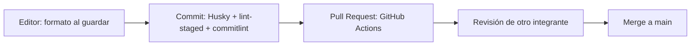
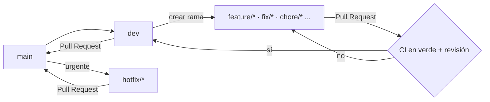

# Estandarización y automatización del proyecto

Este documento reúne las reglas de trabajo del equipo de FitManager y las herramientas que las hacen cumplir de forma automática: estrategia de ramas, estándar de commits, hooks locales, calidad de código, integración continua y protección de la rama principal.

**Principio:** lo que se puede verificar con una herramienta, se verifica con una herramienta. Las reglas que dependen de una persona (por ejemplo, revisar un PR) se limitan a lo que una máquina no puede juzgar.

Cada elemento está marcado con su estado: **Implementado**, **Recomendado** (decidido pero todavía sin configurar) o **Propuesto** (a discutir en el equipo). El resumen completo está en la [sección 12](#12-estado-y-pendientes).

## Índice

1. [Visión general](#1-visión-general)
2. [Estrategia de ramas](#2-estrategia-de-ramas)
3. [Estándar de commits](#3-estándar-de-commits)
4. [Hooks locales: Husky y lint-staged](#4-hooks-locales-husky-y-lint-staged)
5. [Calidad de código: ESLint y Prettier](#5-calidad-de-código-eslint-y-prettier)
6. [Integración continua: GitHub Actions](#6-integración-continua-github-actions)
7. [Protección de ramas y Pull Requests](#7-protección-de-ramas-y-pull-requests)
8. [Entorno, base de datos y dependencias](#8-entorno-base-de-datos-y-dependencias)
9. [Agentes de IA](#9-agentes-de-ia)
10. [Flujo de trabajo completo](#10-flujo-de-trabajo-completo)

---

## 1. Visión general

Cada capa detecta problemas más temprano o más tarde, y la siguiente cubre lo que la anterior no puede evitar:



| Herramienta | Para qué sirve | Dónde se configura | Estado |
|---|---|---|---|
| npm workspaces | Un solo repo con `apps/api`, `apps/web` y `packages/shared` | `package.json` raíz | Implementado |
| ESLint 9 (flat config) | Detectar errores y malas prácticas | `eslint.config.ts` | Implementado |
| Prettier 3 | Formato único del código | `.prettierrc.json`, `.prettierignore` | Implementado |
| Husky 9 | Ejecutar comandos en los hooks de Git | `.husky/` | Implementado |
| lint-staged 16 | Lint y formato solo de los archivos del commit | `package.json` (`lint-staged`) | Implementado |
| Configuración de VS Code | Mismo formato al guardar en todo el equipo | `.vscode/` | Implementado |
| GitHub Actions | Validar lint, formato y build en cada PR | `.github/workflows/ci.yml` | Implementado |
| Ruleset de `main` | Impedir merges con el CI en rojo | GitHub → Settings → Rules | Implementado |
| Docker Compose | Postgres idéntico para todos | `docker-compose.yml` | Implementado |
| Validación de variables de entorno (Zod) | Fallar al arrancar si falta una variable | `apps/api/src/config/env.ts`, `apps/web/src/config/env.ts` | Implementado |
| Prisma Migrate | Esquema de la base versionado | `apps/api/prisma/` | Implementado |
| `AGENTS.md` | Reglas para agentes de IA | Raíz del repo | Implementado |
| commitlint | Validar el formato de los mensajes de commit | `commitlint.config.mjs`, `.husky/commit-msg` | Recomendado |
| Validación del nombre de rama | Rechazar ramas fuera del estándar | `.github/workflows/ci.yml` | Propuesto |
| Plantilla de Pull Request | Que todos los PR digan lo mismo | `.github/pull_request_template.md` | Propuesto |
| `CODEOWNERS` | Revisión obligatoria en zonas críticas | `.github/CODEOWNERS` | Propuesto |
| `.gitattributes` | Evitar diferencias de saltos de línea entre sistemas | Raíz del repo | Recomendado |

---

## 2. Estrategia de ramas

### 2.1 Ramas permanentes

| Rama | Rol | Uso en FitManager |
|---|---|---|
| `main` | Rama principal, siempre estable y lista para producción. | **En uso.** Es la única rama permanente. |
| `dev` | Rama de integración donde se juntan las features antes de pasar a `main` (aparece en Git Flow). | **En uso.** La vamos a empezar a usar a partir de ahora. |

`main` está protegida: no se commitea directamente, todo entra por Pull Request (ver [sección 7](#7-protección-de-ramas-y-pull-requests)).

### 2.2 Ramas de trabajo

Todas salen de `main` o de `dev` y se borran después del merge. El prefijo indica la naturaleza del cambio.

Usamos el nombre del integrante del grupo que va a trabajar en la rama en el nombre de la misma.

| Prefijo | Para qué | Ejemplo |
|---|---|---|
| `feature/` | Desarrollar una funcionalidad nueva. | `feature/crud-socios` |
| `fix/` | Corregir errores no urgentes. | `fix/error-al-guardar-perfil` |
| `hotfix/` | Arreglos urgentes en producción. Salen de `main` y se mergean directo a `main` y a `dev`. | `hotfix/caida-en-pagos` |
| `release/` | Preparar una versión antes de publicarla (últimos ajustes, número de versión, changelog). | `release/1.2.0` |
| `refactor/` | Reestructurar código sin cambiar su comportamiento. | `refactor/separar-servicio-de-pagos` |
| `docs/` | Cambios solo de documentación. | `docs/actualizar-readme` |
| `test/` | Agregar o mejorar tests. | `test/agregar-tests-de-membresias` |
| `chore/` | Mantenimiento que no toca lógica de negocio: dependencias, configuración, scripts. | `chore/actualizar-dependencias` |
| `ci/` | Cambios en la integración continua o en los pipelines. | `ci/agregar-github-actions` |

### 2.3 Reglas del nombre

- Formato: `nombre-inegrante/prefijo/descripcion-corta`.
- Todo en **minúsculas**, con **guiones** entre palabras. Sin espacios, tildes, ñ ni mayúsculas.
- Corto y descriptivo: qué se hace, no quién lo hace ni cuándo.
- Opcionalmente, se antepone el número de issue: `ramiro/feature/12-crud-socios`.
- Una rama, un propósito: si aparece trabajo no relacionado, va en otra rama.

El prefijo de la rama y el tipo del commit no son lo mismo: la rama `feature/` contiene commits de tipo `feat`, y la rama `fix/` contiene commits `fix`. La correspondencia está en la [sección 3.3](#33-relación-entre-ramas-y-commits).

### 2.4 Flujo

**Flujo actual (`main` y `dev`):**



Las ramas de trabajo salen de `dev` y vuelven a `dev` por PR. Cuando hay una versión lista, se abre `release/x.y.z` desde `dev`, se ajusta la versión y el changelog, y se mergea a `main` (con tag) y de vuelta a `dev`. Los `hotfix/` salen de `main` y se mergean a `main` y a `dev`. No se justifica mientras no haya versiones publicadas.

---

## 3. Estándar de commits

Se sigue [Conventional Commits](https://www.conventionalcommits.org/es/).

### 3.1 Formato

```
<tipo>(<alcance opcional>): <descripción>
```

Ejemplos mínimos:

```
feat: agregar login con Google
fix: corregir validación de email
docs: actualizar README
```

### 3.2 Reglas

- **Un commit, un propósito.** Commits chicos que se puedan entender, revisar y revertir por separado.
- **La descripción** va en español, en infinitivo y en minúscula (`agregar`, `corregir`, `actualizar`), **sin punto final**. Se recomienda no pasar los 72 caracteres (el linter permite hasta 100).
- **El mensaje explica el qué y el por qué.** El *qué* ya lo muestra el diff; lo que el diff no muestra es la razón. Cuando la razón no es obvia, va en el cuerpo.

**Tipos permitidos:**

| Tipo | Se usa para |
|---|---|
| `feat` | Una funcionalidad nueva |
| `fix` | La corrección de un error |
| `docs` | Solo documentación |
| `style` | Formato que no cambia el comportamiento (espacios, comas, orden de imports) |
| `refactor` | Reestructurar código sin cambiar su comportamiento |
| `perf` | Mejoras de rendimiento |
| `test` | Agregar o corregir tests |
| `build` | Sistema de build y dependencias |
| `ci` | Configuración de CI y workflows |
| `chore` | Mantenimiento que no encaja en los anteriores |
| `revert` | Revertir un commit anterior |

### 3.3 Relación entre ramas y commits

| Rama | Tipo de commit habitual |
|---|---|
| `feature/` | `feat` |
| `fix/`, `hotfix/` | `fix` |
| `refactor/` | `refactor` |
| `docs/` | `docs` |
| `test/` | `test` |
| `chore/` | `chore`, `build` |
| `style/` | `style` |
| `ci/` | `ci` |
| `release/` | `chore(release): 1.2.0` |

Una rama puede tener commits de distintos tipos: una `feature/` suele incluir también algún `test`, `docs` o `refactor` preparatorio.

### 3.4 Ejemplos

**Bien:**

```
feat(auth): agregar login con identificador de gimnasio

fix(tenant): restringir el modelo Gimnasio en req.db

Antes, req.db.gimnasio.findMany() devolvía los gimnasios de todos los
tenants porque el modelo no figuraba en TENANT_MODELS. Ahora se filtra
por el id del gimnasio autenticado.

refactor(seed): dividir main() en funciones por entidad
```

**Mal:**

| Mensaje | Problema |
|---|---|
| `arreglos` | No dice qué ni por qué. |
| `Fix: cambios varios` | Tipo en mayúscula y varios propósitos mezclados. |
| `feat: agregar socios, corregir login y actualizar dependencias.` | Tres propósitos en un commit; punto final. |
| `wip` | Un commit de trabajo en curso no es historia útil. |

### 3.5 Cómo mantener commits chicos

- Separar los cambios de formato o de refactor de los cambios de comportamiento. Mezclarlos oculta el cambio real en el diff.
- Si ya se modificaron varias cosas, usar `git add -p` para elegir qué entra en cada commit.
- Una migración de Prisma y el código que la usa van **juntos**, porque no tienen sentido por separado.
- Antes de abrir el PR, revisar el historial con `git log --oneline` y reordenar o unir commits con `git rebase -i` si hace falta.

## 4. Hooks locales: Husky y lint-staged

Un hook de Git es un comando que se ejecuta automáticamente en cierto momento (por ejemplo, antes de crear un commit). **Husky** hace que esos hooks vivan dentro del repo en lugar de en la máquina de cada persona, de modo que todo el equipo los comparte.

### 4.1 Cómo funciona

1. `npm install` ejecuta el script `prepare` (`husky`), que activa los hooks de la carpeta `.husky/` en el clon de cada desarrollador. No hay configuración manual.
2. Al hacer `git commit`, Git ejecuta `.husky/pre-commit`, que corre `npx lint-staged`.
3. **lint-staged** ejecuta los comandos configurados **solo sobre los archivos que están en el commit**, no sobre todo el repo. Por eso es rápido.
4. Si un comando falla (por ejemplo, un error de ESLint que no se puede autocorregir), el commit se cancela.

### 4.2 Configuración actual

**`.husky/pre-commit`:**

```bash
npx lint-staged
```

**`package.json` (raíz):**

```json
{
  "lint-staged": {
    "*.{ts,tsx}": ["eslint --fix", "prettier --write"],
    "*.{json,md}": ["prettier --write"]
  }
}
```

| Archivos del commit | Qué se ejecuta |
|---|---|
| `.ts`, `.tsx` | ESLint con autocorrección, luego Prettier |
| `.json`, `.md` | Prettier |

### 4.3 Reglas

- **No se usa `git commit --no-verify`.** Saltear el hook rompe el propósito de tenerlo. El CI lo detectaría igual, pero más tarde y con más costo.
- Si el hook corrige archivos automáticamente, hay que volver a hacer `git add` de los cambios y repetir el commit.
- El hook revisa solo lo que se commitea. La verificación del proyecto completo la hace el CI.

### 4.4 Configuración del editor

`.vscode/settings.json` activa el formato con Prettier al guardar y la corrección automática de ESLint. `.vscode/extensions.json` recomienda las extensiones (ESLint y Prettier) al abrir el repo. Con esto, lo que se ve al guardar coincide con lo que valida el hook.

---

## 5. Calidad de código: ESLint y Prettier

| Archivo | Función |
|---|---|
| `eslint.config.ts` | Única configuración de ESLint, en la raíz. Cubre los tres workspaces con bloques por patrón de archivos. |
| `.prettierrc.json` | Reglas de formato. |
| `.prettierignore` | Archivos que Prettier no toca. |

**Reglas de formato** (`.prettierrc.json`): punto y coma, comillas dobles, coma final `es5`, ancho de línea 100, indentación de 2 espacios, paréntesis siempre en funciones flecha.

**Principios:**

- **Una sola configuración de ESLint, en la raíz.** No se crean `eslint.config` por workspace: el editor usaría el más cercano e ignoraría el de la raíz.
- **ESLint se ocupa de los errores; Prettier, del formato.** `eslint-config-prettier` va al final de la configuración para desactivar reglas de ESLint que compiten con Prettier. No se agregan reglas de formato a ESLint.
- La configuración es un array plano. No se usa `tseslint.config()` porque está deprecado.
- `no-console` avisa: en la API se usa el `logger` (Pino), no `console.log`. Se permiten `console.warn` y `console.error`.
- `any` genera una advertencia.

**Comandos:**

```bash
npm run lint           # revisar
npm run lint:fix       # revisar y corregir
npm run format         # formatear todo
npm run format:check   # solo verificar (lo que usa el CI)
```

---

## 6. Integración continua: GitHub Actions

La fuente de verdad es `.github/workflows/ci.yml`; este apartado resume qué hace y por qué.

### 6.1 Cuándo corre

- En cada **Pull Request** hacia `main`.
- En cada **push** a `main`.

Si se sube un commit nuevo a un PR mientras hay una corrida en curso, la anterior se cancela (`concurrency` con `cancel-in-progress`).

### 6.2 Qué verifica

El job **"Lint y build"** ejecuta, en un entorno limpio:

| Paso | Comando | Qué detecta |
|---|---|---|
| Instalar dependencias | `npm ci` | Un `package-lock.json` desactualizado respecto de los `package.json` |
| Lint | `npm run lint` | Errores de ESLint |
| Formato | `npm run format:check` | Archivos sin formatear |
| Prisma Client | `npm run prisma:generate -w apps/api` | Errores en `schema.prisma`; deja generado el cliente que necesita el build |
| Build | `npm run build` | Errores de TypeScript e imports rotos en API y web |

### 6.3 Decisiones de configuración

- **Node 22**, porque Vite 8 y Prisma 7 requieren `^20.19 || >=22.12`.
- **`actions/checkout@v7` y `actions/setup-node@v7`**, con caché de npm. Al subir de versión mayor, revisar los avisos de deprecación de la pestaña Actions.
- **`permissions: contents: read`**: el workflow solo puede leer el repo. Se amplía únicamente si un paso lo necesita.
- **`timeout-minutes: 15`**: evita que una corrida colgada consuma minutos.
- **`DATABASE_URL` ficticia** en el paso de `prisma generate`: `prisma.config.ts` la lee, pero generar el cliente no se conecta a ninguna base.
- **`VITE_API_URL` ficticia** en el build del frontend.
- **El cliente de Prisma no se commitea**: se genera en cada corrida, por eso el paso existe.

### 6.4 Reproducir el CI en local

```bash
npm ci
npm run lint
npm run format:check
npm run prisma:generate -w apps/api
npm run build
```

Si pasan en local, pasan en GitHub.

### 6.5 Mejoras previstas

- **Tests:** cuando existan (Vitest + Supertest), se agrega un job con un servicio de Postgres. El más importante es el que verifica el aislamiento entre gimnasios.
- **Validación de commits y de nombres de rama** (secciones 3.6 y 2.5).
- **Actualización de dependencias** con Dependabot o Renovate.

---

## 7. Protección de ramas y Pull Requests

### 7.1 Ruleset de `main` — Implementado

Configurado en GitHub (**Settings → Rules → Rulesets**). Exige que el check **"Lint y build"** pase antes de poder mergear. En consecuencia, no se puede integrar código que no compile o no pase el lint, y todo cambio llega por Pull Request.

### 7.2 Recomendado para el ruleset y el repo

- Exigir **1 aprobación** como mínimo. Con cuatro integrantes, es la forma de que nadie integre código sin que otra persona lo haya leído.
- **Bloquear force-push** y el borrado de `main`.
- Usar **Squash and merge** como método de integración, para que `main` quede con un commit por PR y el título del PR sea el mensaje (ver 3.7).
- Activar **"Automatically delete head branches"**, para que las ramas se borren solas al mergear.

### 7.3 Plantilla de Pull Request — Propuesto

**`.github/pull_request_template.md`:**

```markdown
## Qué cambia
<!-- Describir el cambio y, sobre todo, por qué -->

## Cómo se probó
- [ ] `npm run lint`
- [ ] `npm run format:check`
- [ ] `npm run build`
- [ ] Probado manualmente (describir cómo)

## Checklist
- [ ] La rama y los commits siguen el estándar
- [ ] Actualicé la documentación y `.env.example` si hizo falta
- [ ] Si toca migraciones, multi-tenancy o autenticación, pedí revisión a otro integrante
- [ ] Puedo explicar cada parte de este cambio

## Asistencia de agentes
<!-- ¿Se usó un agente? ¿Qué se revisó a mano? -->
```

### 7.4 Revisión obligatoria en zonas críticas — Propuesto

Con un archivo `CODEOWNERS` y la opción *Require review from Code Owners* del ruleset, ciertos archivos exigen la aprobación de personas específicas:

```
# .github/CODEOWNERS  (reemplazar por los usuarios reales de GitHub)
/apps/api/prisma/                 @usuario1 @usuario2
/apps/api/src/config/tenant.ts    @usuario1 @usuario2
/apps/api/src/modules/auth/       @usuario1 @usuario2
/.github/                         @usuario1 @usuario2
```

---

## 8. Entorno, base de datos y dependencias

### 8.1 Variables de entorno

- Nunca se commitea un `.env`. Se commitea el `.env.example` correspondiente.
- Cada variable nueva se **valida con Zod** (`config/env.ts`) y se agrega al `.env.example` en el mismo PR.
- En el frontend solo las variables con prefijo `VITE_` llegan al navegador: nunca se pone un secreto ahí.

| Archivo | Contenido |
|---|---|
| `.env` (raíz) | Credenciales y puerto de Postgres para Docker Compose |
| `apps/api/.env` | `DATABASE_URL`, `PORT`, `JWT_SECRET`, `NODE_ENV` |
| `apps/web/.env` | `VITE_API_URL` |

### 8.2 Postgres con Docker Compose

`docker-compose.yml` levanta Postgres 16 con un volumen persistente y un healthcheck. Comandos: `npm run db:up`, `db:down`, `db:logs` y `db:reset` (este último **borra todos los datos locales**). El puerto del host se define con `POSTGRES_PORT`: en Windows, un Postgres nativo puede ocupar el 5432 y causar errores de autenticación engañosos.

### 8.3 Prisma

- Cada cambio de `schema.prisma` genera una **migración nueva** que se commitea. **Las migraciones ya commiteadas no se editan.**
- El cliente generado (`apps/api/src/generated/`) **no se commitea**; se regenera con `prisma:generate`.
- Prisma 7 busca `prisma.config.ts` en el directorio actual: los comandos se ejecutan con los scripts de la raíz o con `-w apps/api`.
- Cuando cambia el schema, se actualiza también `prisma/seed.ts`.

### 8.4 npm workspaces

- `npm install` siempre desde la raíz; nunca dentro de `apps/*`.
- Hay **un único `package-lock.json`**, en la raíz.
- Todo paquete que se importa se declara en el `package.json` del workspace que lo usa, aunque funcione sin declararlo (evita dependencias fantasma). Se verifica con `npx depcheck apps/api`.
- Antes de escribir código con una librería, se consulta su versión en `package-lock.json` para no usar APIs deprecadas.

### 8.5 Saltos de línea (Windows) — Recomendado

El equipo trabaja en Windows, donde Git puede convertir los saltos de línea a CRLF, mientras que Prettier y el CI usan LF. Un archivo `.gitattributes` en la raíz lo evita:

```
* text=auto eol=lf
```

### 8.6 Versión de Node

Vite 8 y Prisma 7 requieren `^20.19.0 || >=22.12.0`. Conviene que el campo `engines` del `package.json` raíz diga lo mismo (hoy dice `>=20`) y agregar un archivo `.nvmrc` con `22`, para que todos usen la versión del CI.

---

## 9. Agentes de IA

Las reglas para trabajar con agentes (Claude Code, Cursor, Codex, Copilot, etc.) están en `AGENTS.md`, en la raíz. Define el contexto del proyecto, los comandos, las versiones y APIs a evitar, las reglas de multi-tenancy y tres niveles de permisos (hacer sin preguntar, preguntar primero, nunca).

- **Claude Code** lee `CLAUDE.md`. Para que use `AGENTS.md` en todas las versiones, el repo incluye un `CLAUDE.md` con una sola línea: `@AGENTS.md`.
- Los archivos personales de agentes (`CLAUDE.local.md`, `.claude/settings.local.json`) están en `.gitignore`.
- Las ramas y los commits que produce un agente siguen **este mismo estándar**.
- Cada integrante es responsable de lo que sube, lo haya escrito un agente o no, y debe poder explicarlo.

---

## 10. Flujo de trabajo completo

```bash
# 1. Partir de dev actualizada
git checkout dev
git pull

# 2. Crear la rama de la tarea
git checkout -b feature/crud-socios

# 3. Trabajar y commitear en pasos chicos
git add -p
git commit -m "feat(socios): agregar listado con búsqueda"
# Husky corre lint-staged (y commitlint, cuando esté activo)

# 4. Verificar lo mismo que verificará el CI
npm run lint
npm run format:check
npm run prisma:generate -w apps/api
npm run build

# 5. Subir la rama y abrir el Pull Request
git push -u origin feature/crud-socios
```

Después:

1. Abrir el PR hacia `main` con título en formato Conventional Commits y la plantilla completa.
2. Esperar el check **"Lint y build"**. Si falla, corregir en la misma rama y pushear de nuevo.
3. Pedir revisión a otro integrante (obligatoria si toca migraciones, multi-tenancy o autenticación).
4. Integrar con **Squash and merge** una vez aprobado y en verde.
5. Borrar la rama y actualizar `main` en local:

```bash
git checkout main
git pull
git branch -d feature/crud-socios
```

