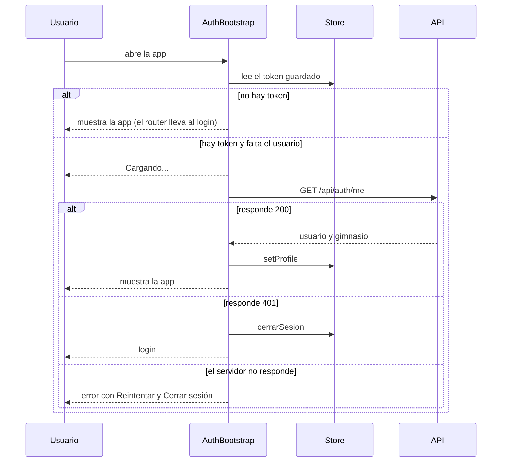

# Frontend: autenticación y base de la aplicación

Documentación de la base de `apps/web`: cómo se maneja la sesión, cómo se llama a la API, cómo se protegen las rutas y qué convenciones seguir con Zustand, shadcn/ui y los formularios. La contraparte del backend está en `auth.md`.

**Versiones de referencia:** React 19.3 (con React Compiler) · React Router 7.18 · Zustand 5.0 · TanStack Query 5.10 · axios 1.20 · React Hook Form 7.88 · Zod 4.6 · Tailwind 4.3 · Vite 8.3 · shadcn 4.21 sobre Base UI 1.8 · Vitest 5.1 · MSW 3.0

---

## 1. Resumen

- La sesión se guarda en un **store de Zustand**. Solo se persiste en `localStorage` el **token** y el **último gimnasio**; el usuario se vuelve a pedir a la API en cada arranque.
- Toda llamada a la API pasa por **un único cliente de axios** (`lib/api-client.ts`), que agrega el token y cierra la sesión si la API responde `401`.
- Las rutas se protegen con tres *guards*: `GuestOnly` (solo sin sesión), `RequireAuth` (con sesión) y `RequireRole` (por rol).
- Los formularios usan **React Hook Form + Zod**, con los componentes `Field` de shadcn.
- El token se guarda en `localStorage` (ver sección 8 para el motivo y sus riesgos).

---

## 2. Estructura

```
apps/web/src/
├── api/
│   └── auth.api.ts                 Funciones que llaman a la API (login, getMe)
├── components/ui/                  Componentes de shadcn (generados por el CLI)
├── config/
│   └── env.ts                      Variables de entorno validadas con Zod
├── features/auth/
│   ├── components/
│   │   ├── AuthBootstrap.tsx       Restaura la sesión al abrir la app
│   │   └── guards.tsx              GuestOnly, RequireAuth, RequireRole
│   ├── hooks/useLogin.ts           Mutación de login (TanStack Query)
│   ├── pages/LoginPage.tsx
│   ├── redirect.ts                 A dónde volver después de iniciar sesión
│   ├── schemas.ts                  Validación del formulario (Zod)
│   ├── session.ts                  cerrarSesion()
│   └── types.ts                    Usuario, Gimnasio, Perfil, Sesion, Rol
├── layouts/
│   ├── AppLayout.tsx               Encabezado, navegación y botón "Salir"
│   └── AuthLayout.tsx              Contenedor centrado del login
├── lib/
│   ├── api-client.ts               Instancia de axios con interceptores
│   ├── api-error.ts                ApiError y getErrorMessage
│   ├── query-client.ts             Configuración de TanStack Query
│   └── utils.ts                    cn() (lo genera shadcn)
├── pages/                          Dashboard, Usuarios (placeholder), 404 y 403
├── routes/index.tsx                Definición de rutas
├── store/auth.store.ts             Store de Zustand
└── main.tsx                        Punto de entrada
```

Los tests viven aparte, en `apps/web/tests/`. Ver `docs/frontend/testing-frontend.md`.

**Dependencias entre capas** (nunca al revés, para evitar importaciones circulares):

```
api/  →  lib/api-client  →  features/auth/session  →  store/  +  lib/query-client  →  lib/api-error
```

El store no importa nada de la API ni del cliente HTTP: solo guarda estado.

---

## 3. Cómo funciona la sesión

### Estados

El estado de la sesión **no se guarda en una variable**: se calcula a partir de `token` y `usuario` (`getAuthStatus` en `store/auth.store.ts`).

| Estado | Condición | Qué pasa |
|---|---|---|
| `unauthenticated` | No hay token | Se muestra el login |
| `checking` | Hay token, falta saber quién es | Se pide el perfil a la API; mientras tanto, "Cargando…" |
| `authenticated` | Hay token y usuario | Se muestra la aplicación |

Derivarlo evita que una variable aparte se desincronice de los datos reales.

### Qué se guarda dónde

| Dato | Dónde | Por qué |
|---|---|---|
| `token` | Memoria **y** `localStorage` | Permite seguir logueado al recargar |
| `ultimoSlug` | Memoria **y** `localStorage` | El login viene con el gimnasio precargado |
| `usuario`, `gimnasio` | Solo memoria | Se piden a `GET /api/auth/me` en cada arranque, así el rol y los datos nunca quedan desactualizados |

En `localStorage`, bajo la clave `fitmanager-auth`, solo aparecen `token` y `ultimoSlug`.

### Al abrir la app



`AuthBootstrap` (en `main.tsx`) envuelve al router. Para pedir el perfil usa `useQuery` y guarda el resultado en el store dentro del propio `queryFn`, en lugar de copiarlo con un `useEffect` (las reglas del React Compiler prohíben llamar a `setState` de forma sincrónica dentro de un efecto).

### Iniciar sesión

1. `LoginPage` valida los campos con Zod en el cliente.
2. `useLogin` (`useMutation`) llama a `POST /api/auth/login`.
3. Si responde bien, `setSession` guarda token, usuario y gimnasio, y recuerda el slug.
4. El estado pasa a `authenticated`. `GuestOnly` detecta el cambio y redirige solo a la página que el usuario quería abrir. **Ningún componente navega a mano después del login.**
5. Si la API rechaza las credenciales, se muestra su mensaje (`Credenciales inválidas`) y no se cierra ni redirige nada.

### Cambiar la contraseña propia

`POST /api/auth/change-password` cierra todas las sesiones del usuario, incluida la actual, y responde con una sesión nueva. `useChangePassword` la guarda con `setSession`: si no lo hiciera, el token viejo daría `401` en el próximo request y el cliente cerraría la sesión. Las otras sesiones del usuario (otra pestaña con otro login, otro dispositivo) se cierran solas en su próximo request.

### Cerrar sesión

`cerrarSesion()` (`features/auth/session.ts`) hace dos cosas: borra la sesión del store y **vacía la caché de TanStack Query**, para que el siguiente usuario que inicie sesión no vea datos del anterior. La usan el botón "Salir" y el interceptor de respuestas.

---

## 4. Llamadas a la API

### El cliente (`lib/api-client.ts`)

- `baseURL` es `VITE_API_URL` + `/api`, con un tiempo máximo de 15 segundos.
- **Request:** agrega `Authorization: Bearer <token>` si hay sesión. Lee el token con `useAuthStore.getState()`, porque un interceptor no es un componente y no puede usar hooks.
- **Response:** todo error se convierte en un `ApiError`. Si la respuesta es `401` en cualquier ruta que no sea `/auth/login` ni `/auth/register-gimnasio`, se ejecuta `cerrarSesion()` y los guards llevan al login.

En login y registro un `401` significa "credenciales incorrectas", no "sesión vencida": por eso están excluidos.

> Los interceptores de **request** de axios se ejecutan en orden inverso al de registro (el último registrado corre primero). Los de **response**, en orden directo.

### Errores (`lib/api-error.ts`)

La API siempre responde los errores con la forma `{ error: string, details?: ... }`. El cliente los convierte en:

```ts
class ApiError extends Error {
  status: number | null;   // null = no hubo respuesta (servidor caído, sin red, CORS)
  details: unknown;
}
```

| Caso | `status` | `message` |
|---|---|---|
| La API respondió con un error | El código HTTP | El campo `error` de la respuesta |
| No hubo respuesta | `null` | `No se pudo conectar con el servidor` |
| Cualquier otro | `null` | `Ocurrió un error inesperado` |

Para mostrar un error en pantalla se usa `getErrorMessage(error)`; nunca el error crudo de axios.

### TanStack Query (`lib/query-client.ts`)

- **No reintenta** los errores del cliente (`4xx`): no se arreglan reintentando. Ante errores del servidor o de red reintenta hasta 2 veces.
- `refetchOnWindowFocus` está desactivado.
- Se usa `useMutation` para escribir (login) y `useQuery` para leer.

---

## 5. Rutas y guards

Las rutas se declaran como **datos** (`routes/index.tsx` exporta un `RouteObject[]`), y `main.tsx` crea el router con `createBrowserRouter`. Así las mismas rutas se pueden reutilizar en tests con `createMemoryRouter`.

| Ruta | Guard | Contenido |
|---|---|---|
| `/login` | `GuestOnly` | `LoginPage` dentro de `AuthLayout` |
| `/` | `RequireAuth` | `DashboardPage` dentro de `AppLayout` |
| `/usuarios` | `RequireAuth` + `RequireRole(ADMIN)` | `UsuariosPage` |
| cualquier otra | — | `NotFoundPage` |

| Guard | Qué hace |
|---|---|
| `GuestOnly` | Si ya hay sesión, redirige. Es lo que lleva al usuario a su destino después de iniciar sesión. |
| `RequireAuth` | Si no hay sesión, redirige a `/login` y **recuerda** la página que quería abrir. |
| `RequireRole` | Si el rol no está permitido, muestra `ForbiddenPage` **sin cambiar la URL**. |

`RequireRole` evita mostrar una pantalla que después fallaría, pero **no es seguridad**: el backend vuelve a verificar el rol en cada request.

**Volver a la página pedida** (`features/auth/redirect.ts`): solo se aceptan rutas internas que empiezan con `/` (no `//`, que sería una redirección a otro sitio) y nunca se vuelve a `/login`.

---

## 6. Zustand: convenciones

Zustand es un store **fuera de React**: un objeto con estado y acciones, sin `Provider`.

```ts
export const useAuthStore = create<AuthState>()(persist((set) => ({ ... }), { ... }));
```

Los **dos paréntesis** de `create<...>()(...)` son un requisito de TypeScript para inferir los tipos de los middlewares.

### Reglas

1. **Siempre con selector.** `useAuthStore((s) => s.token)` re-renderiza solo si cambia el token. `useAuthStore()` sin selector se suscribe a todo: evitarlo.
2. **Un selector que devuelve un objeto nuevo rompe el render en Zustand 5.** Da `Maximum update depth exceeded` y el aviso `The result of getSnapshot should be cached`. Dos soluciones:

```ts
// Valores simples, cada uno con su selector
const nombre = useAuthStore((s) => s.usuario?.nombre);
const rol = useAuthStore((s) => s.usuario?.rol);

// Varios valores en un objeto: useShallow compara el contenido, no la identidad
const { usuario, gimnasio } = useAuthStore(
  useShallow((s) => ({ usuario: s.usuario, gimnasio: s.gimnasio }))
);
```

3. **Fuera de React** se usa `getState()` / `setState()`: en interceptores, en `queryFn`, en funciones utilitarias.
4. **Las acciones viven en el store** (`setSession`, `logout`), no en los componentes.
5. **Derivar, no duplicar:** si un dato se puede calcular de otros (como `status`), no se guarda.
6. **Estado del cliente en Zustand, datos del servidor en TanStack Query.** El token y la identidad de la sesión van en Zustand; las listas (socios, usuarios, pagos) van en TanStack Query.

### `persist`

- `partialize` elige qué se guarda: solo `token` y `ultimoSlug`.
- Con `localStorage`, el estado se restaura **de forma síncrona** al crear el store.
- Si en el futuro cambia la forma del estado guardado, hay que subir `version` y definir `migrate`; si no, los navegadores con datos viejos pueden quedar con un estado inválido.
- **No hay sincronización entre pestañas:** si se cierra sesión en una, las demás se enteran recién cuando hacen una petición y reciben un `401`.

---

## 7. shadcn/ui: convenciones

### Qué es

No es una dependencia: el CLI **copia el código** de cada componente a `src/components/ui/`, y desde ahí es del proyecto y se puede editar. Las actualizaciones no llegan solas.

| Pieza | Para qué sirve |
|---|---|
| `components.json` | Configura el CLI: estilo, rutas y alias. Un `style` que empieza con `base-` genera componentes con **Base UI**; el resto, con Radix. |
| `cn()` | Une clases de Tailwind y resuelve conflictos (`cn("px-2", "px-4")` da `px-4`). Lo provee el paquete `cn` (el reemplazo de `clsx` + `tailwind-merge` que usa shadcn; no es una dependencia accidental). |
| Variantes (`cva`) | `variant` y `size` de `Button` se traducen en clases. `buttonVariants()` da esas clases para usar en otros elementos, por ejemplo un `Link`. |
| Tokens de color | `bg-background`, `text-muted-foreground`, `text-destructive`… apuntan a variables CSS de `index.css`. Para cambiar el tema se cambian las variables. |

### Agregar un componente

Desde `apps/web`:

```bash
cd apps/web
npx shadcn@latest add dialog
```

### Base UI: `render` en lugar de `asChild`

```tsx
// Radix (tutoriales viejos, muchas respuestas en internet): NO funciona en este proyecto
<DialogTrigger asChild><Button>Abrir</Button></DialogTrigger>

// Base UI (este proyecto)
<DialogTrigger render={<Button />}>Abrir</DialogTrigger>
```

Al copiar un ejemplo hay que fijarse que no use `asChild`.

### Formularios: `Controller` + `Field`

El componente `Form` viejo de shadcn quedó atrás. La documentación oficial arma los formularios con `Controller` de React Hook Form y `Field` de shadcn:

```tsx
<Controller
  name="email"
  control={form.control}
  render={({ field, fieldState }) => (
    <Field data-invalid={fieldState.invalid}>
      <FieldLabel htmlFor="login-email">Email</FieldLabel>
      <Input {...field} id="login-email" type="email" aria-invalid={fieldState.invalid} />
      {fieldState.invalid && <FieldError errors={[fieldState.error]} />}
    </Field>
  )}
/>
```

| Pieza | Rol |
|---|---|
| `Controller` | Conecta un input con el formulario. Entrega `field` (`value`, `onChange`, `onBlur`, `name`, `ref`) y `fieldState` (`invalid`, `error`). |
| `{...field}` | Hace que el `Input` sea controlado por el formulario. |
| `data-invalid` en `Field` | Tiñe la etiqueta de rojo. |
| `aria-invalid` en el `Input` | Pinta el borde y avisa a los lectores de pantalla. Las dos marcas van **siempre juntas**. |
| `FieldLabel htmlFor` | Asocia la etiqueta con el input por su `id`. |
| `FieldError errors` | Muestra el mensaje de Zod. |
| `FieldGroup` | Apila los campos con espaciado. |

Otros detalles del formulario de login:

- `noValidate` en el `<form>`: valida Zod, no el navegador.
- Un botón fuera del `<form>` se vincula con el atributo `form="id-del-form"`.
- Los `autoComplete` (`username`, `current-password`) permiten que los gestores de contraseñas funcionen.
- Los errores que devuelve la API se muestran en un `<p role="alert">` aparte, con `getErrorMessage`.

Cuando los formularios se repitan, conviene extraer un componente que encapsule `Controller` + `Field`; hasta entonces se escribe explícito.

---

## 8. Decisiones

| Decisión | Motivo | Cómo cambiarla |
|---|---|---|
| **Token en `localStorage`** | Es lo más simple y deja el backend como está. Su riesgo: una vulnerabilidad XSS podría leerlo. Se mitiga con la protección por defecto de React (que escapa el contenido), evitando `dangerouslySetInnerHTML`, y con que el token dura 8 horas. | Una cookie `httpOnly` es más segura, pero exige cambios en el backend (cookies, CORS con credenciales, protección CSRF). La decisión está aislada en la configuración de `persist` y en el interceptor de request. |
| **El perfil se pide en cada arranque** | El rol y los datos siempre están actualizados, y no se guarda nada sensible. | Agregar `usuario` a `partialize` (no recomendado). |
| **El `queryFn` de `/me` escribe en el store** | Evita un `useEffect` que copie datos. | — |
| **`status` derivado** | No puede desincronizarse del token ni del usuario. | — |
| **Recordar el último gimnasio** | El slug hay que escribirlo en cada login. | Quitar `ultimoSlug` del store. |
| **Rutas como datos** | Se reutilizan en tests con `createMemoryRouter`. | — |

---

## 9. Recetas

### Llamar a un endpoint nuevo

El token y el manejo del `401` ya los resuelve el cliente: solo se escribe la función y el hook.

```ts
// src/api/socios.api.ts
export async function listarSocios(): Promise<Socio[]> {
  const { data } = await apiClient.get<Socio[]>("/socios");
  return data;
}

// src/features/socios/hooks/useSocios.ts
export function useSocios() {
  return useQuery({ queryKey: ["socios"], queryFn: listarSocios });
}
```

### Agregar una página protegida

En `routes/index.tsx`, dentro del bloque de `RequireAuth` y `AppLayout`. Si es solo para administradores, dentro del bloque de `RequireRole`:

```tsx
{
  element: <RequireRole roles={["ADMIN"]} />,
  children: [
    { path: "usuarios", element: <UsuariosPage /> },
    { path: "reportes", element: <ReportesPage /> },
  ],
},
```

Y, si va en el menú, un `NavLink` en `AppLayout`.

### Leer la sesión en un componente

```ts
const rol = useAuthStore((s) => s.usuario?.rol);
```

### Mostrar el error de una mutación

```tsx
{mutation.error && <p role="alert">{getErrorMessage(mutation.error)}</p>}
```

---

## 10. Entorno y comandos

`apps/web/.env` (el `.env.example` correspondiente se commitea):

```
VITE_API_URL=http://localhost:3000
```

- Es **solo el origen** de la API, **sin `/api`**: el cliente lo agrega.
- Solo las variables con prefijo `VITE_` llegan al navegador. **Nunca** poner secretos ahí.
- Vite lee el `.env` al arrancar: después de cambiarlo hay que reiniciar el servidor.
- La variable se valida con Zod en `config/env.ts`: si falta o no es una URL, la app lanza un error al cargar.
- Los tests están incluidos en `tsconfig.app.json` (`"include": ["src", "tests"]`), así que `npm run build -w apps/web` también revisa sus tipos.
- En `vite.config.ts` y `vitest.config.ts` se usa `import.meta.dirname` (no `__dirname`), y los imports entre archivos de configuración llevan extensión. Si no, Vite 8 avisa que su cargador de configuración nativo dejará de aceptarlos.

```bash
npm run dev              # API y web
npm run dev:web          # solo la web (http://localhost:5173)
npm run build -w apps/web
npm run lint
npm test -w apps/web     # tests del frontend (no necesitan la API ni Postgres)
```

La API tiene `cors()` abierto a cualquier origen; se restringe al dominio del frontend en el deploy (Epic 8).

---

## 11. Reglas de código (React Compiler y ESLint)

El proyecto usa React Compiler y `eslint-plugin-react-hooks` 7, que incluye reglas del compilador. Las que más se notan:

| Regla | Qué evitar |
|---|---|
| `react-hooks/set-state-in-effect` | Llamar a `setState` de forma sincrónica dentro de un `useEffect`. Para pedir datos, usar TanStack Query. |
| `react-hooks/refs` | Leer o escribir `ref.current` durante el render. |
| `react-hooks/purity` | Cálculos impuros durante el render (`Date.now()`, `Math.random()`). |
| `react-hooks/immutability` | Mutar valores que vienen de props, estado o hooks. |
| `react-refresh/only-export-components` | Un archivo de componentes que también exporta funciones o constantes. Por eso `guards.tsx` solo exporta componentes y la lógica de `redirect.ts` está aparte. |

Otras convenciones:

- Imports con el alias `@/` (por ejemplo `@/lib/api-client`).
- El `tsconfig` de Vite tiene `erasableSyntaxOnly` y `verbatimModuleSyntax`: nada de *parameter properties* en clases, y los tipos se importan con `import type`.
- Textos de interfaz y mensajes de error en español.

---

## 12. Verificación manual

Casi todos estos casos están automatizados (ver `docs/frontend/testing-frontend.md`). Esta verificación manual sirve para revisar el aspecto visual y el comportamiento en un navegador real, que los tests no cubren.

Con el backend y la base cargada con `npm run db:seed`, en `http://localhost:5173`:

| Probá | Datos | Esperado |
|---|---|---|
| Abrir la raíz sin sesión | — | Lleva a `/login` |
| Campos vacíos | — | Mensajes de validación, sin llamada a la API |
| Contraseña incorrecta | `fitzone-bahia-blanca` · `admin@fitzone.com` · otra | `Credenciales inválidas`; se queda en el login |
| Administrador | `fitzone-bahia-blanca` · `admin@fitzone.com` · `admin123` | "Hola, Ana" y enlace a Usuarios |
| Recepcionista | `powergym-punta-alta` · `admin@fitzone.com` · `recepcion123` | Sin enlace a Usuarios; `/usuarios` muestra el aviso de permisos |
| Volver a la página pedida | Abrir `/usuarios` sin sesión y entrar como admin | Termina en `/usuarios` |
| Recargar con sesión | F5 | Sigue adentro; `localStorage` solo tiene `token` y `ultimoSlug` |
| Token inválido | Cambiar el token en `localStorage` y recargar | Vuelve al login |
| API caída | Apagar la API y recargar | "No pudimos conectar con el servidor" y "Reintentar" |
| Cerrar sesión | "Salir" | Login con el gimnasio precargado |
| Cambiar la contraseña | "Cambiar contraseña" con la actual correcta | "Contraseña actualizada" y sigue adentro; otro navegador con una sesión del mismo usuario vuelve al login en el próximo request |

---

## 13. Problemas frecuentes

| Síntoma | Causa probable | Solución |
|---|---|---|
| Página en blanco | Un error de JavaScript antes del primer render | Abrir la consola del navegador (F12) y la terminal de `npm run dev`; casi siempre es una de las filas siguientes |
| `Variables de entorno inválidas` | Falta `VITE_API_URL` en `apps/web/.env` | Crearla y reiniciar Vite |
| `Failed to resolve import "@/..."` | Falta el alias en `vite.config.ts` | Agregar `resolve.alias` con `"@"` apuntando a `./src` |
| El editor no reconoce `@/...` pero Vite sí | `paths` está solo en el `tsconfig.json` raíz, que no incluye archivos | Agregar `paths` también en `tsconfig.app.json` y reiniciar el servidor de TypeScript |
| `Option 'baseUrl' is deprecated` | TypeScript 6 | Quitar `baseUrl` y dejar solo `paths` |
| `Element type is invalid: ... got: undefined` | Un componente de shadcn no existe con ese nombre | Revisar qué exporta el archivo en `components/ui/` |
| `Failed to resolve import "@/components/ui/..."` | Falta instalar un componente | `npx shadcn@latest add <nombre>` desde `apps/web` |
| `Maximum update depth exceeded` con Zustand | Un selector devuelve un objeto nuevo en cada render | Selectores simples o `useShallow` (sección 6) |
| Un `asChild` no hace nada | Ejemplo pensado para Radix | Usar la prop `render` (sección 7) |
| La app queda en "Cargando…" | La API no responde o `VITE_API_URL` es incorrecta | Si el servidor no responde aparece el error con "Reintentar"; revisar la URL (sin `/api`) |
| Error de CORS en la consola | La API no está accesible o rechaza el origen | Verificar que la API esté corriendo en la URL de `VITE_API_URL` |
| Después de cambiar un rol sigue viéndose el menú viejo | El perfil se pide al abrir la app | Recargar la página |
| Cerré sesión en una pestaña y la otra sigue abierta | `persist` no sincroniza pestañas | Se desloguea sola con el primer `401` |
| `(!) Your Vite config uses features that are unsupported by configLoader: 'native'` | `__dirname` en `vite.config.ts`, o un import sin extensión entre archivos de configuración | Usar `import.meta.dirname` y poner la extensión (`"./vite.config.ts"`) |
| Un test falla o se comporta de forma rara | Casi siempre es un handler faltante en la API falsa, un diálogo o aviso que se interpone, o estado que se filtra entre tests | Ver `docs/frontend/testing-frontend.md`, sección 13 |

---

## 14. Pendientes

| Tema | Detalle |
|---|---|
| Pruebas en un navegador real | Los tests corren en jsdom contra una API falsa (ver `docs/frontend/testing-frontend.md`). Falta una prueba de punta a punta en un navegador real, por ejemplo con Playwright. |
| Tamaño del bundle | El build avisa que supera los 500 kB; se resuelve con carga diferida por ruta cuando haya más pantallas |
| Sincronización entre pestañas | Ver sección 6 |
| Refresh tokens | No existen: pasadas las 8 horas hay que volver a iniciar sesión |
